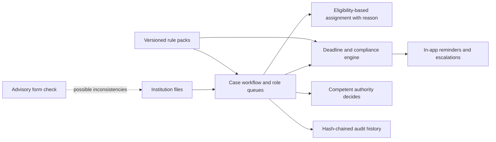

# AICTE Approval Workflow and Compliance Platform

**SIH 2026 · Problem statement SIH26262 · Team GeoLogics**

A prototype for coordinating AICTE approval cases: role-based work queues, explained assignment, deadline and compliance tracking, in-app alerts, audit history, and versioned rules. The platform organizes review work; **only a competent authority makes an approval decision**, with a human action and reason.

> This is a student prototype, not an official AICTE system. People, institutions, cases, benchmark records, and form-check datasets are synthetic. Rule values and timelines are placeholders that require AICTE validation.

## The problem and our approach

Approval workflows span applicants, reviewers, committees, and decision-makers. Documents, returns, deadlines, handoffs, and rule changes need to stay connected to each case so the current owner can see what is due and why.

This prototype represents that work as a case lifecycle. Each case has a state, current holder, deadlines, assignments, and an audit trail. Rule packs are versioned, and each application records the version under which it was filed. The system can flag possible form inconsistencies, but the check is advisory and never decides a case.

## How it works



The application uses React, TypeScript, Vite, and Tailwind for the web interface; Express, Prisma, and PostgreSQL for the API and data; and a Python FastAPI service for the optional model-assisted form check. A pair of scheduler processes uses a PostgreSQL advisory lock so one leader runs the deadline engine at a time.

## What is implemented

- Case transitions with role checks and a visible holder, including a blocked state when no eligible officer can take work.
- Assignment rules that consider eligibility, capacity, availability, continuity, and workload; the decision stores a reason.
- Deadline clocks that pause when the college holds a returned case and resume with the remaining time.
- In-app reminders, escalation, exception flags, and scheduler leader failover.
- Append-only audit protections for the application role and a hash-chain integrity check. A privileged database owner remains outside this protection boundary.
- Versioned rule packs with maker-checker publication. Substantive sections, including `timelines`, remain pinned to the case's version; operational sections follow the current published version.
- A rules-plus-model form check that suggests issues and leaves filing and decisions to people.

The prototype covers phases 0–4 of the submitted design plus yearly rule packs and a government-style interface, about 40% by scope as described in [Architecture versus prototype](docs/evidence/ARCHITECTURE_VS_PROTOTYPE.md). Phases 5–8 and production hardening are not built.

## Evidence and limitations

### Engine and read-screen benchmark

The latest committed benchmark artifact is [`f78d82e.json`](docs/evidence/benchmark-results/f78d82e.json), measured on 4 November 2026 at commit `f78d82e` using 15,000 synthetic applications on one 4-core host.

- The first deadline-engine cycle took **131.5 s**; the second took **68.1 s**.
- The second cycle created **0 new alerts** and recorded **6,490 duplicate attempts suppressed**. Those are distinct counts: suppressed attempts are not alerts delivered.
- Five read screens each handled 400 requests at concurrency 20 with zero reported errors; the slowest p95 was **2.30 s**.


Both engine cycles exceeded the demo's one-minute interval. This is one synthetic-data measurement on a single machine, not a production or multi-region performance claim. See [benchmark methodology and full results](docs/evidence/BENCHMARKS.md).

### Form-check evaluation

On synthetic forms, the hybrid form check reports precision **0.975**, overall recall **0.863**, and false-alarm rate **2.2%**. Recall on unit errors is **0.315**, a known weakness. See [the evaluation report](formcheck/EVALUATION.md) and [evidence guide](docs/evaluation/README.md).

### Evidence guide

The [evaluation guide](docs/evaluation/README.md) connects each major claim to its implementation, evaluation method, result, and limitations. Browse the [workflow diagrams](docs/evidence/WORKFLOW.md), [phase inventory](docs/evidence/ARCHITECTURE_VS_PROTOTYPE.md), and [feasibility gaps](docs/evidence/FEASIBILITY.md) for detail.

The [interactive benchmark explorer](docs/index.html) reads the committed JSON runs and lets evaluators switch between run records and benchmark questions. To view it locally, run `python3 -m http.server 8000 --directory docs` and open <http://localhost:8000>. A manual Pages workflow is prepared; Pages is not configured or deployed yet. See [publishing instructions](docs/README.md). The Markdown reports and raw data remain browsable here.

Administrators can open the in-app Evidence Center at `/admin/evidence/overview` for eight sections of workflow, assignment, scheduler, alert, audit, ML-evaluation and performance evidence. The read-only ADMIN API draws live figures from the demo database and committed evaluation artifacts; each panel shows scope, source and measurement definition. Synthetic benchmarks and ML results are labelled, and missing verification is shown as not verified. See the [implementation record](docs/evidence/README.md).

## Run the prototype

Requirements: Docker Compose, Node.js 22.12+, Python 3.11+ for local form-check work, and Git. The demo password for fictional seeded users is `demo1234`.

```bash
git clone https://github.com/sanjayvasudevan-c/SIH_project-repo.git
cd SIH_project-repo
git switch main
cp .env.example .env
npm run setup
docker compose build api
docker compose build scheduler
docker compose build web
docker compose build formcheck
docker compose up -d
```

Open <http://localhost:8080> and choose a demo user. **`npm run setup` recreates the local `aicte` database and discards its existing demo data.** Use it only for a fresh checkout or when you intend to replace that data. Full instructions and safety notes are in [Local setup and verification](docs/development/LOCAL_SETUP.md); the role-by-role flow is in the [Demo walkthrough](docs/development/DEMO_SCRIPT.md).

Useful checks after setup:

```bash
npm test
npm run test:web
npm run test:formcheck
npm --workspace api run typecheck
npm --workspace web run build
node --test scripts/*.test.mjs
npm run evidence:verify
```

The API suite and evidence verifier require the configured PostgreSQL database. The Evidence Center UI reads the ADMIN-only API; `npm run evidence:verify` compares API aggregates with independent SQL.

## Demo and team

- [Hosted prototype](https://aicte-demo-website.vercel.app) — the main-branch Vercel deployment was successful on 4 November 2026; the separate open Dependabot Vitest preview failed and is documented in the [Evidence Center record](docs/evidence/README.md).
- [SIH presentation](docs/presentation/GeoLogics_SIH2026_Presentation.pptx)
- [Demo video](https://drive.google.com/file/d/1MtdBjbsbe71ODzVC4wfgrNmJwZF5oWQB/view?usp=sharing)
- [Team GeoLogics contributors](CONTRIBUTORS.md)

## Repository map

| Path | Purpose |
|---|---|
| `api/` | Express API, workflow and deadline engine, Prisma schema, migrations, tests |
| `web/` | React application and frontend tests |
| `formcheck/` | Python form-check service, model evaluation, and synthetic dataset generators |
| `shared/` | Shared seed rules and expression variables |
| `docs/evaluation/` | Evaluator narrative tying claims to implementation and evidence |
| `docs/evidence/` | Benchmark artifacts, charts, architecture, audit, and Evidence Center implementation record |
| `docs/engineering/` | Preserved plans and design specifications |
| `docs/development/` | Local setup and demo walkthrough |
| `docs/screens/` | Recorded interface screenshots |

See [all project documentation](docs/README.md) and the [decision log](DECISIONS.md) for the complete map and design rationale.
