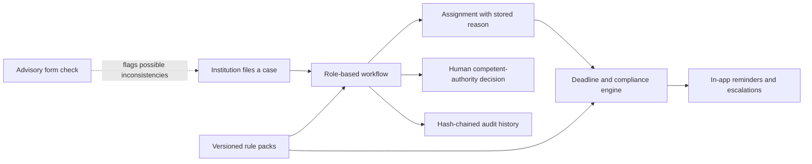

# SIH evaluation guide

This prototype addresses SIH problem statement **SIH26262**, *Integrated AICTE Approval Workflow Automation, Compliance Monitoring and Alert Management System*. It models an approval case from filing through review and decision, with deadline tracking, role-based work queues, assignment explanations, audit history, and versioned rules.

The system assists with routing and compliance work. It does not make approval decisions: a competent authority must choose approve, approve with conditions, or reject and give a reason. The prototype uses fictional people, institutions, applications, and placeholder AICTE rules.

## How the prototype works

The architecture and phase scope are described in [Architecture versus prototype](../evidence/ARCHITECTURE_VS_PROTOTYPE.md). Four code-grounded workflow diagrams are in [Workflow diagrams](../evidence/WORKFLOW.md).

## Evidence by capability

### Rules remain explainable as they change

**Problem:** A rule amendment during a cycle can affect filed cases and create uncertainty about which requirements applied.

**Capability and implementation:** Each application is pinned to a rule-pack version. Substantive sections—including `timelines`—stay pinned, while operational sections follow the current published pack. The boundary is explicit in [`PINNED_SECTIONS`](../../api/src/rules/schema.ts) and enforced by [`mergeSections`](../../api/src/rules/resolved.ts). Maker-checker publication and guarded version transitions are implemented in [`versions.ts`](../../api/src/rules/versions.ts).

**Evaluation:** [`rules-api.test.ts`](../../api/test/rules-api.test.ts) and [`rules-a11.test.ts`](../../api/test/rules-a11.test.ts) cover pinning, amendments, and live-case safety. The full API test suite can be run with `npm test` after the local database setup.

**What the evidence establishes:** The prototype enforces versioned rule behavior for its modeled data and test cases.

**Limitations:** The rule values and the choice of pinned versus operational sections are placeholders pending AICTE validation. This is not an official rule source.

### Workflow and deadlines are explicit

**Problem:** Cases involve multiple roles, handoffs, return-to-college periods, and deadlines that must be visible to the current owner.

**Capability and implementation:** [`transitions.ts`](../../api/src/workflow/transitions.ts) defines allowed state transitions. [`deadlines.ts`](../../api/src/workflow/deadlines.ts) pauses and resumes stage clocks; [`cycle.ts`](../../api/src/engine/cycle.ts) processes reminders, overdue work, and escalations.

**Evaluation:** [`workflow.test.ts`](../../api/test/workflow.test.ts), [`actionCenter.test.ts`](../../api/test/actionCenter.test.ts), and scheduler tests exercise transitions, clock behavior, and leader election. The test command is `npm test`.

**What the evidence establishes:** The implemented transition and clock behavior is exercised against the prototype's database model.

**Limitations:** Calendars, holidays, time limits, and escalation thresholds are synthetic placeholders. In-app notifications exist; email and SMS delivery do not.

### Assignment decisions retain a reason and candidate trace

**Problem:** A work assignment should be explainable, including when no eligible officer can take the task.

**Capability and implementation:** [`assignment/engine.ts`](../../api/src/assignment/engine.ts) applies eligibility rules and stores an assignment reason. `AssignmentTrace` stores the candidate list and exclusions for automatic decisions, including the `BLOCKED` path.

**Evaluation:** [`assignment-trace.test.ts`](../../api/test/assignment-trace.test.ts) and [`assignment.test.ts`](../../api/test/assignment.test.ts) cover trace data and assignment selection. ADMIN users can inspect persisted automatic-assignment traces in the in-app Evidence Center. Manual assignments do not write candidate traces. See the [implementation record](../evidence/README.md).

**What the evidence establishes:** Automatic assignment decisions can be inspected from persisted source records.

**Limitations:** Manual assignment changes do not create an automatic-decision trace. Capacities, weights, and thresholds require AICTE validation. Seeded workload is synthetic and does not establish real-world fairness.

### The deadline engine was exercised at 15,000 synthetic applications

**Problem:** A workflow prototype needs a repeatable way to assess engine behavior and response latency at a larger dataset size.

**Capability and evaluation:** [`load-test.ts`](../../api/scripts/load-test.ts) prepares 15,000 applications, runs two engine cycles, and sends 400 requests per screen at concurrency 20. The committed run is [`f78d82e.json`](../evidence/benchmark-results/f78d82e.json), produced at commit `f78d82e` on 4 November 2026. The [benchmark report](../evidence/BENCHMARKS.md) explains the method and preserves the earlier run separately.

**Measured result:** In that one run, the first cycle took 131.5 seconds and created 10,282 alerts while suppressing 47 duplicate attempts. The second took 68.1 seconds, created no new alerts, and suppressed 6,490 duplicate attempts. Each of the five read screens completed 400 requests with zero reported errors; the slowest p95 was 2.30 seconds.

**Limitations:** This is one synthetic-data run on a single 4-core host, not a production or multi-region benchmark. Both engine cycles exceeded the demo's one-minute interval. The measurement does not establish performance on real AICTE traffic.

### Audit changes can be detected through the application checks

**Problem:** A case history needs ordered, verifiable records and a clear boundary around privileged database access.

**Capability and implementation:** [`audit.ts`](../../api/src/lib/audit.ts) maintains hash chains. [`001_audit_guard.sql`](../../api/prisma/sql/001_audit_guard.sql) removes update/delete privileges from the application role and installs a guard trigger.

**Evaluation:** [`audit.test.ts`](../../api/test/audit.test.ts) covers chain verification and database-role protections. The audit verification endpoint is implemented in [`routes/admin.ts`](../../api/src/routes/admin.ts) (search for `/audit/verify`).

**What the evidence establishes:** The application role cannot silently update or delete audit rows; an edit that does not recompute the forward chain is detectable.

**Limitations:** A privileged database owner can disable the trigger or rewrite the chain. This is not tamper-proof against a database administrator.

### The form check is advisory and has a known weakness

**Problem:** Form inconsistencies can create avoidable review work, but automated checks must not replace human judgment.

**Capability and evaluation:** The Python service combines rules and an Isolation Forest model. The reproducible synthetic-data results are in [`formcheck/EVALUATION.md`](../../formcheck/EVALUATION.md) and [`metrics.json`](../../formcheck/metrics.json).

**Measured result:** The hybrid evaluation reports precision **0.975**, overall recall **0.863**, and false-alarm rate **2.2%**. Recall for unit errors is only **0.315**.

**Limitations:** These measurements use synthetic forms and do not demonstrate performance on real applications. The low unit-error recall is a known weakness. The feature is advisory and never blocks filing.

## Overall limits

- This is a prototype covering phases 0–4 plus yearly rule packs and the interface add-on; phases 5–8 and production hardening are not built. See [scope by phase](../evidence/ARCHITECTURE_VS_PROTOTYPE.md).
- The seeded people, institutions, workflows, and benchmark data are fictional or synthetic.
- The Evidence Center is an ADMIN-only app feature. Its API and panels are read-only; it is a prototype over synthetic and demo data, not a production monitoring service.
- CI is configured in [GitHub Actions](../../.github/workflows/ci.yml). This guide does not assert a hosted CI result; check the Actions page for current status.
- Deployment and operational readiness have not been established by this repository review.

## Continue reading

- [Benchmark methodology and full results](../evidence/BENCHMARKS.md)
- [Evidence Center source and API data contract](../evidence/README.md)
- [Initial audit](../evidence/INITIAL_AUDIT.md)
- [Feasibility and production gaps](../evidence/FEASIBILITY.md)
- [Local setup and verification](../development/LOCAL_SETUP.md)
