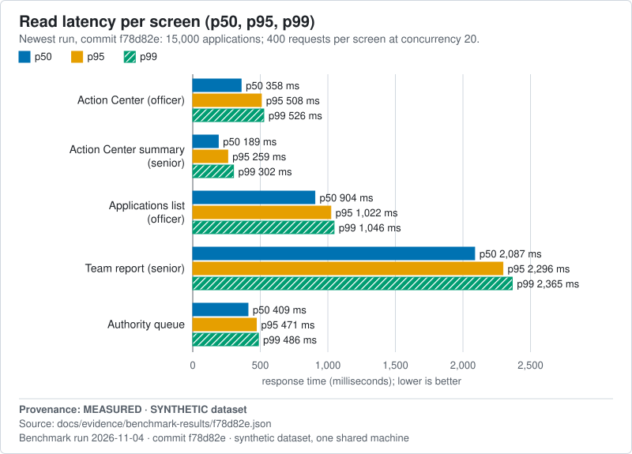
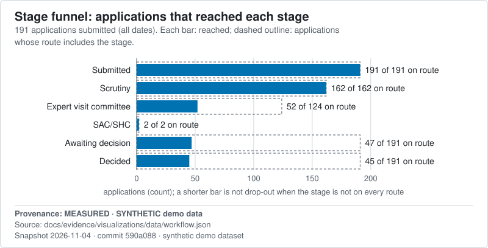
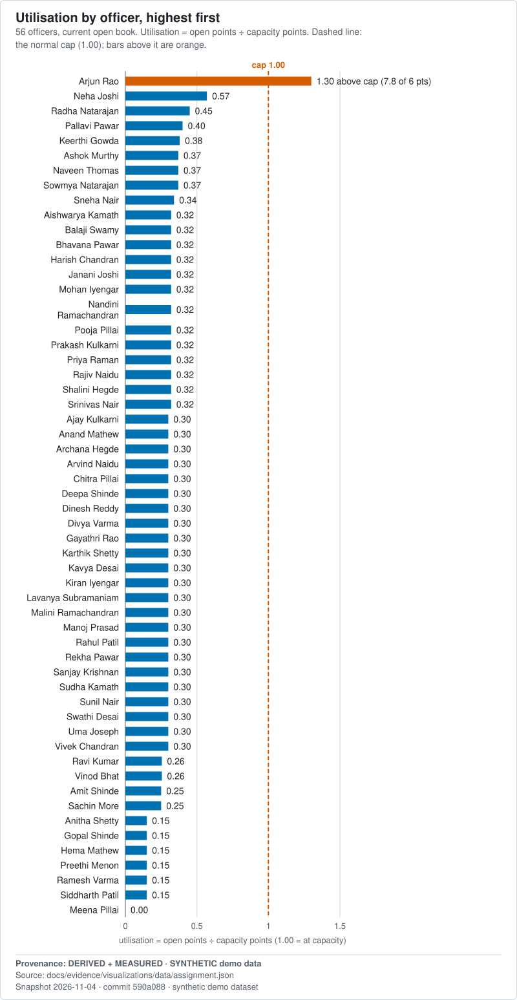
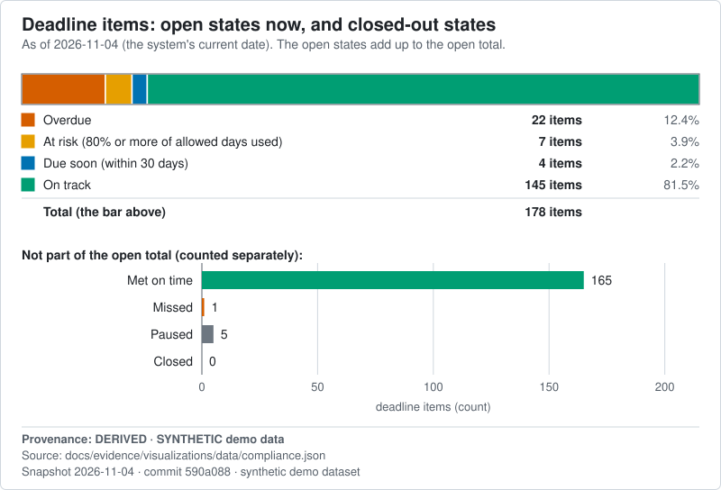
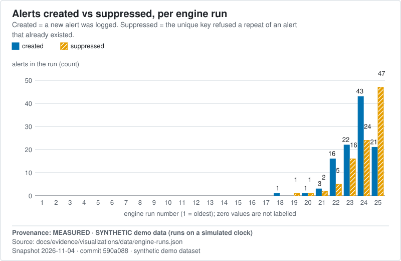
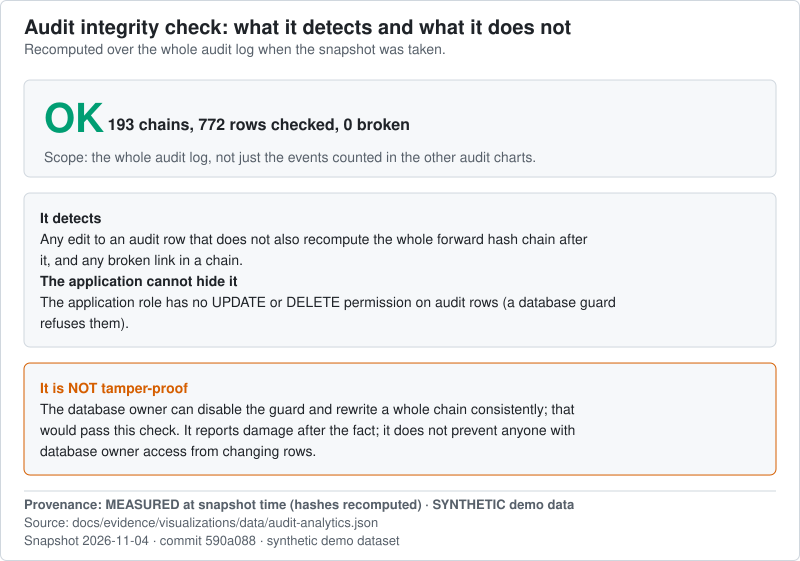
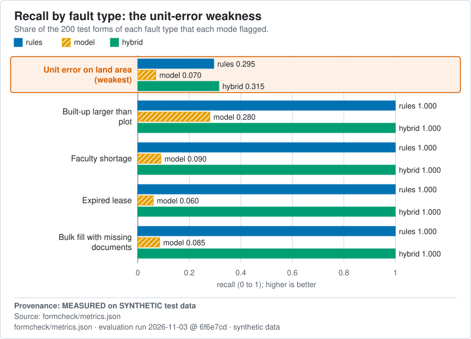

# Evidence index

Every number here is traceable to a command you can run, and every chart can be read on GitHub without running anything. The core of the evidence is the [**visualization package**](visualizations/README.md): 33 charts and 5 architecture diagrams, generated from committed data, each with its source, provenance and the commit it was taken at, and each explained in four parts (what it shows, how it was measured, what you can reasonably conclude, what you cannot).

**All data is a synthetic demo dataset** (a seed script plus a simulated clock). Nothing here is real AICTE data, and nothing claims production readiness.

## Key charts



**Speed.** Response times of five screens at a large synthetic scale, from a recorded load test. [Benchmarks](visualizations/benchmarks/README.md) · [method and tables](BENCHMARKS.md)



**Workflow.** Where applications are, against the stages on their route. [Workflow charts](visualizations/workflow/README.md) · [diagrams](WORKFLOW.md)



**Assignment.** Officer load against capacity; the officer above the cap is highlighted, and a [worked example](visualizations/assignment/WORKED_EXAMPLE.md) quotes the stored decisions. [Assignment charts](visualizations/assignment/README.md)



**Deadlines.** Open deadline items by state, adding up to the open total. [Scheduler and compliance charts](visualizations/scheduler-compliance/README.md)



**Duplicate prevention.** Repeat alerts refused by the database's unique key, run by run. [Alerts and audit charts](visualizations/alerts-audit/README.md)



**Audit.** What the integrity check detects, and why it is not tamper-proof. [Alerts and audit charts](visualizations/alerts-audit/README.md)



**Form-check model.** Strong on the faults its rules describe, weak on unit errors, on synthetic data only. [ML charts](visualizations/ml/README.md)

## Browse

| | |
|---|---|
| [Visualization index](visualizations/README.md) | All charts by category, with the four-part explanation under each |
| [Architecture diagrams](visualizations/architecture/README.md) | System, workflow state machine, assignment flow, deadline engine, evidence pipeline (Mermaid) |
| [Methodology](visualizations/METHODOLOGY.md) | Provenance classes, how each figure is produced, how to regenerate, limitations |
| [Inventory](visualizations/INVENTORY.md) | Every visualization, its file and its source data |
| [Initial audit](INITIAL_AUDIT.md) | What was measured in this repository before anything was added, including the one failing test it found |
| [Architecture vs prototype](ARCHITECTURE_VS_PROTOTYPE.md) | Phases 0 to 8 against what is built, each feature marked Tested, Recorded demo or Not built |
| [Workflow diagrams](WORKFLOW.md) | Case lifecycle, assignment, escalation ladder, rule-pack publish, each tied to its source file |
| [Benchmarks](BENCHMARKS.md) | Two recorded runs at 15,000 applications, one command to reproduce |
| [Design comparison](COMPARISON.md) | Six design properties, each with the file that implements it |
| [Feasibility](FEASIBILITY.md) | Licence cost, rollout, hosting, what is absent and what needs AICTE validation |

## Verify it

Run from the repository root with the demo database up (see the root README for setup).

```bash
npm run evidence:verify      # every headline number recomputed with separate raw SQL; exit 0 = all agree
npm run evidence:snapshot    # runs that comparison first, then writes visualizations/data/ (refuses on any disagreement)
npm run evidence:visualize   # regenerates every chart and README from the committed data
npm run evidence:links       # every relative link in the evidence documents resolves
node --test scripts/*.test.mjs
```

`npm run demo:reset` rebuilds the local demo database; never run it against a shared or hosted database.

What `evidence:verify` proves: the aggregate code's numbers match an independent query of the same database on four date windows (all dates, the last 30 days of the data, the busiest day, an empty range), so a wrong join or a double count would show as a disagreement. What it does not prove: that the stored data is true; that the SQL is right (two queries by the same team can share a misunderstanding); the individual at-risk, due-soon and on-track split (only their sum is checked); the wording of definitions; recomputation of audit hashes (linkage and counts only; the integrity card itself recomputes hashes); or safety against a concurrent writer between the two reads. Its database session is read-only and it writes no audit row. The result recorded with the committed data is in [`visualizations/data/manifest.json`](visualizations/data/manifest.json).

## CI

`.github/workflows/ci.yml` runs on pushes to `main`, every pull request, a daily schedule and manual dispatch, as independent jobs (no `needs:`), so one can fail alone:

```
API typecheck                  prisma generate, then tsc --noEmit
Web build                      web tests (npm --workspace web run test), then vite build
API tests                      PostgreSQL 16 service container; uploads JUnit XML and commit.txt
Form-check tests and ML        generate, train, pytest; the reproducibility check is non-fatal
Chart generator tests          node --test scripts/*.test.mjs
```

`benchmark.yml` is separate, manual and weekly, never per pull request; it uploads results and the regenerated benchmark charts as a workflow artifact and never commits. No lint job exists because the repository has no linter configured.

**CI has never run on GitHub.** The workflows are written and read back against the repository's commands, but nothing here has been observed executing on GitHub's runners.

## What this evidence deliberately does not claim

* **No "production-ready" claim.** Phase 8 hardening (2FA, SSO, row-level security, DPDP review, audit shipping) is not in this build.
* **No tamper-proof-against-a-DBA claim.** The audit guard stops the *application* role, and the integrity check detects any edit that does not recompute the forward chain. The table owner can disable the trigger.
* **No exactly-once external delivery claim.** `AlertLog`'s unique key makes the *decision* to alert exactly-once. There is no external channel in this build, so there is nothing to deliver and nothing to claim. An outbox belongs with the real gateways in phase 8.
* **No real-AICTE accuracy claim.** Every ML figure is synthetic: 0.975 precision, 0.863 overall recall, 0.315 recall on unit errors, 2.2% false alarms. The unit-error weakness is shown, not buried. The submission text's earlier "0.89" recall and "2.9%" false-alarm figures were wrong and are the claim being corrected.
* **No requirement coverage matrix.** It needs the official SIH26262 problem statement text, which is not in the repository. Paste it into `docs/evidence/PROBLEM_STATEMENT.md` and the matrix can be built against it. Writing it from a reading of the README would put a paraphrase in the "official requirement" column.
* Acknowledgement of alerts is not recorded; the time from an alert to its deadline item closing is recorded per item but not computed; and the benchmark has two single runs on one shared machine, so no variance is claimed.
