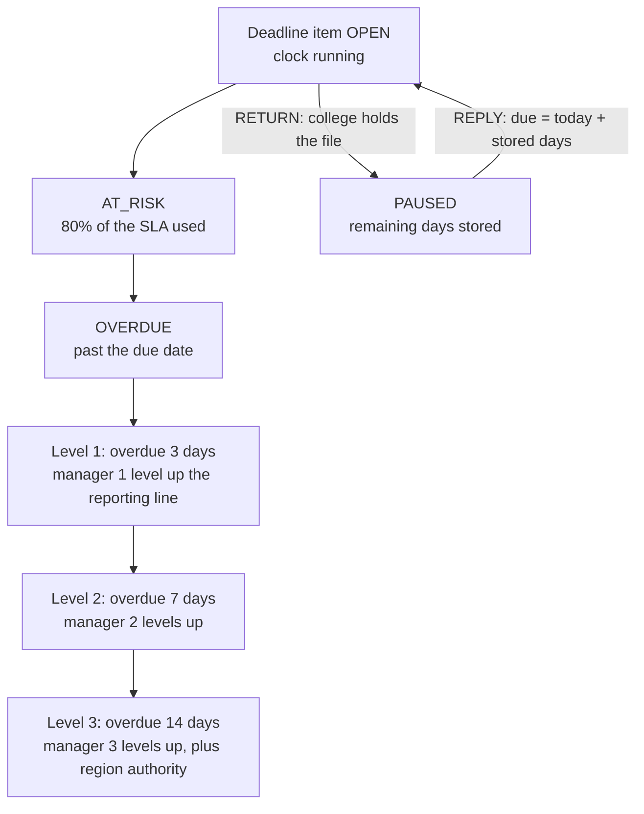
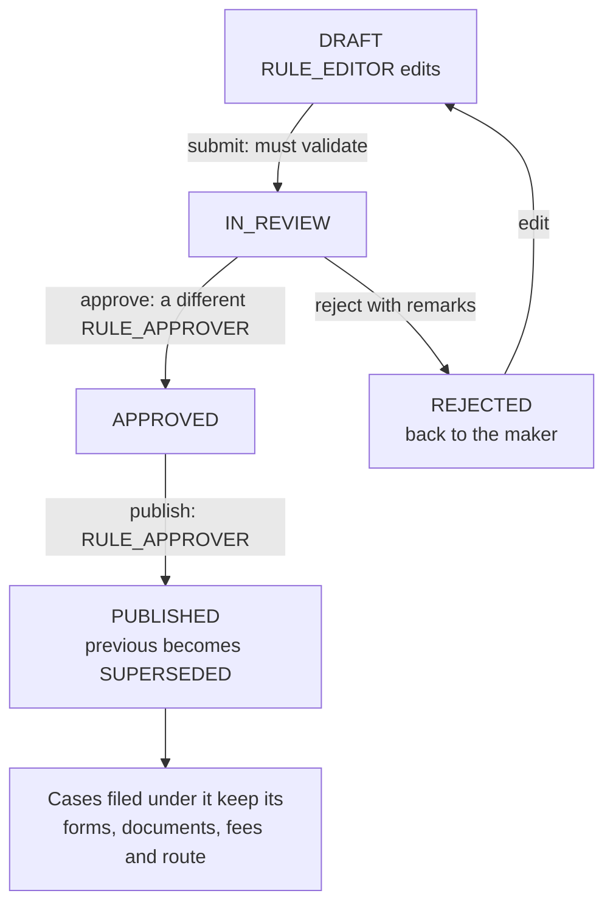

# Workflow diagrams

Four diagrams, each drawn from the code it cites, not from how approval workflows usually work. Each is kept small enough to read on a phone. State, role and action names are spelled as the code spells them.

## 1. Case lifecycle

**What it proves:** a case can only move along a fixed table of transitions, each limited to named roles, and the system records who holds it, or that nobody does when no officer is eligible (see diagram 2).

Source: `api/src/workflow/transitions.ts` (the `TRANSITIONS` table); holders from the `holderType` writes in `api/src/workflow/actions.ts`; per-case checks in `api/src/policy/can.ts`.

Caveats:
- Stage order is the case's `route`, set from the rule pack by application type, so `COMPLETE_STAGE` goes to the next stage on that route (drawn as EVC); a route need not include every stage.
- A case with no eligible officer is `IN_STAGE` with holder `NONE` (diagram 2), not only after a decision.

## 2. Assignment decision

**What it proves:** an officer is chosen by a fixed, explainable order of steps, and when nobody is eligible the case is visibly blocked and escalated to a person instead of being assigned arbitrarily.

Source: `api/src/assignment/engine.ts`: `loadCandidates` and `filterCandidates` (filters), `selectOfficer` (continuity, then `score`, looping over tiers), `assign` (the blocked branch).

Caveats:
- Continuity applies only to `RE_SCRUTINY` (the officer who returned the case) and `SCRUTINY` / `VERIFY` (the institution's portfolio officer); other tasks go straight to the score.
- Tiers, caps and score weights come from the rule pack's assignment section. A blocked task records a `BLOCKED` flag, an `ASSIGN_FAILED` audit row and a notice to the region HoD.

## 3. Escalation ladder

**What it proves:** overdue work climbs the reporting line on fixed day counts, each step fires once, and a case waiting on the college does not run the officer's clock.

Source: `api/src/engine/cycle.ts`, `processItem` (`AT_RISK`, `OVERDUE`, `ESCALATION`) and `escalationTarget`; the cycle selects only items with status `OPEN`. Pause and resume: `pauseStageItem` and `resumeStageItem` in `api/src/workflow/deadlines.ts`.

Caveats:
- Escalation walks up the responsible user's `reportsTo` chain and falls back to the region HoD when the chain ends. In the seeded hierarchy the three levels are senior, super senior and head of department.
- The 80% and the 3 / 7 / 14 are rule pack values, shown at their seeded values (`shared/seed/rules.json`); stage deadlines count working days.
- `AlertLog`'s unique key makes the decision to alert once per item and level. Alerts are in-app notifications; this build has no external channel.

## 4. Rule-pack publish

**What it proves:** nobody can change the rules that govern cases alone: the author cannot approve their own change, published versions are never edited, and filed cases keep the substantive rules they were filed under, while operational rules (schedule, reminders, escalation, assignment) follow the cycle's current published version.

Source: `api/src/rules/versions.ts` (`submitVersion`, `approveVersion`, `rejectVersion`, `publishVersion`, `approverConflict`); the trigger in `api/prisma/sql/002_rulepack_guard.sql` re-checks the transitions and blocks content changes after the draft stage.

Caveats:
- Pinning is partial: `mergeSections` (`api/src/rules/resolved.ts`) takes schedule, reminders, escalation, assignment, committees and calendar from the cycle's currently published version; everything else stays on the case's own version.
- A published amendment can move open cases onto the new version where its apply scope allows (`rebaseAfterPublish`).
