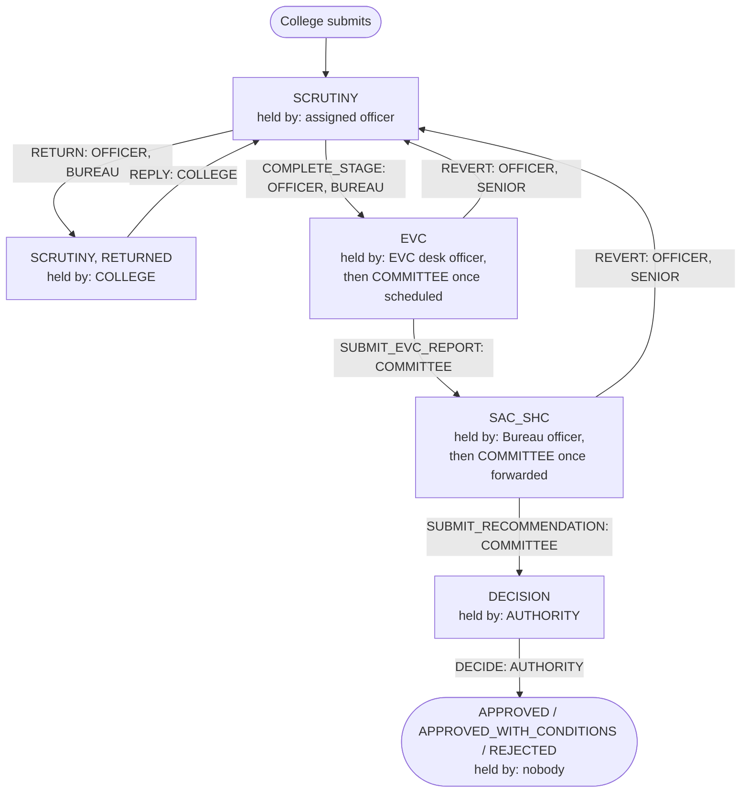
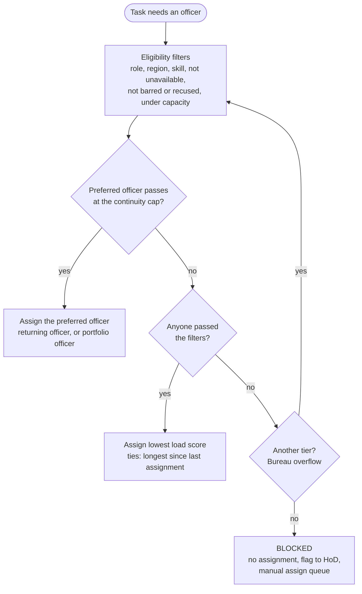
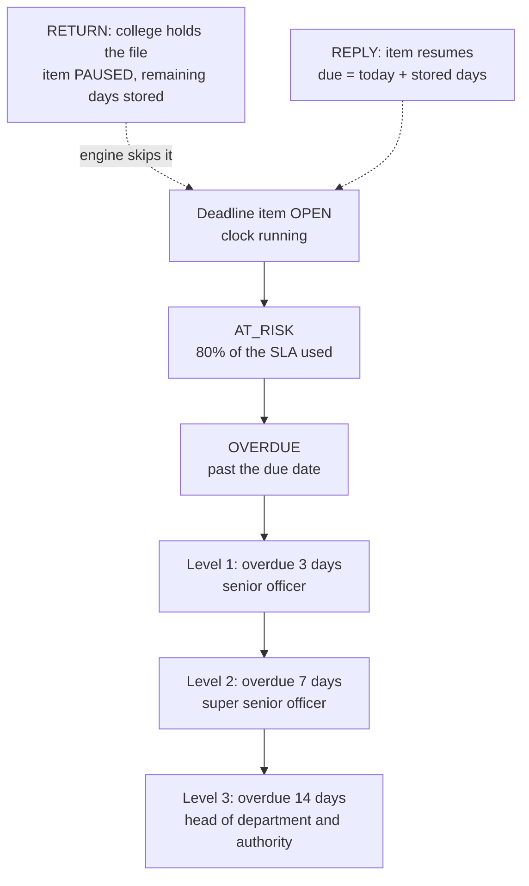
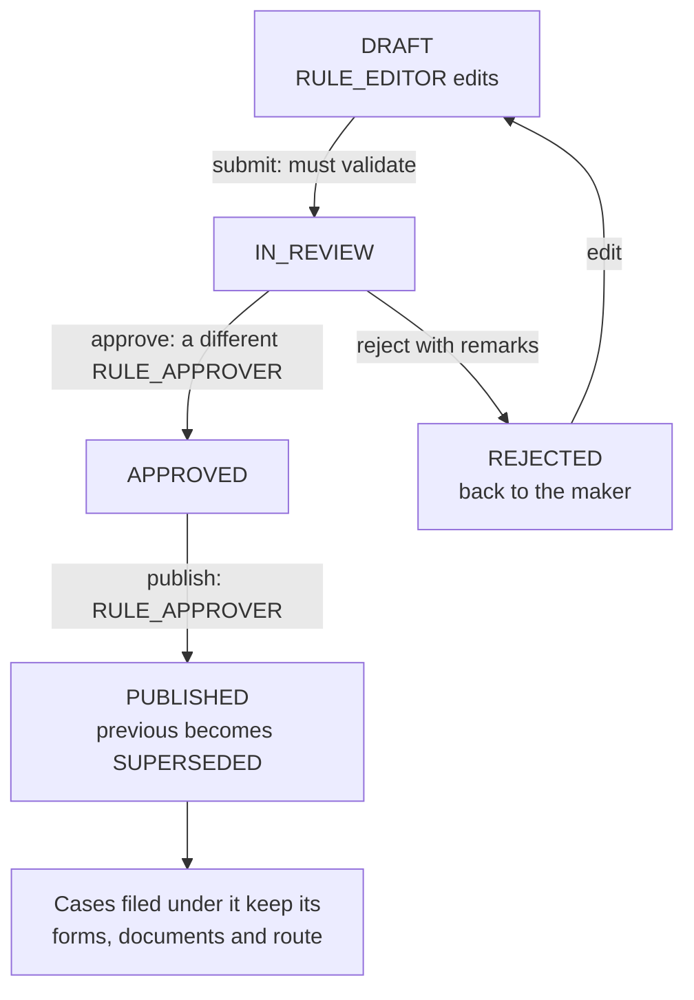

# Workflow diagrams

Four diagrams, each drawn from the code it cites, not from how approval workflows usually work. Each is kept small enough to read on a phone. State, role and action names are spelled as the code spells them.

## 1. Case lifecycle

**What it proves:** a case can only move along a fixed table of transitions, each limited to named roles, and at every point the system records exactly who holds it.

Source: `api/src/workflow/transitions.ts` (the `TRANSITIONS` table: actions, permitted roles, and the stage and status each applies from). Who holds the case in each state comes from the `holderType` writes in `api/src/workflow/actions.ts`. Each action is also checked per case in `api/src/policy/can.ts`: scope, the open assignment, and for `DECIDE` a separation-of-duties rule that bars an authority who handled the case earlier. The stage order is the case's `route`, set from the rule pack by application type, so `COMPLETE_STAGE` goes to the next stage on that route (drawn here as EVC); a route need not include every stage.

## 2. Assignment decision

**What it proves:** an officer is chosen by a fixed, explainable order of steps, and when nobody is eligible the case is visibly blocked and escalated to a person instead of being assigned arbitrarily.

Source: `api/src/assignment/engine.ts`: `loadCandidates` and `filterCandidates` (filters), `selectOfficer` (continuity, then `score` and `byScore`, looping over tiers), `assign` (the blocked branch: `ExceptionFlag` with reason `BLOCKED`, an `ASSIGN_FAILED` audit row, and a notice to the region HoD). Every pick stores its reason text and the rule pack version in force. The tiers, caps and score weights come from the rule pack's assignment section, not from constants in the engine.

## 3. Escalation ladder

**What it proves:** overdue work climbs a fixed management chain on fixed day counts, each step fires once, and a case waiting on the college does not run the officer's clock.

Source: `api/src/engine/cycle.ts`, `processItem` (the `AT_RISK`, `OVERDUE` and `ESCALATION` steps, and `escalationTarget` for the chain; the cycle selects only items with status `OPEN`). The pause and resume are `pauseStageItem` and `resumeStageItem` in `api/src/workflow/deadlines.ts`. The 80% and the 3 / 7 / 14 are rule pack values (`atRiskPct`, `escalation.thresholds`), shown here at their seeded values in `shared/seed/rules.json`; stage deadlines count them in working days. Each alert is guarded by `AlertLog`'s unique key, so the decision to alert is made once per item and level. Alerts are in-app notifications; this build has no external channel.

## 4. Rule-pack publish

**What it proves:** nobody can change the rules that govern cases alone: the author cannot approve their own change, published versions are never edited, and filed cases keep the rules they were filed under.

Source: `api/src/rules/versions.ts` (`submitVersion`, `approveVersion`, `rejectVersion`, `publishVersion`; `approverConflict` refuses anyone who drafted or edited the version). The database trigger in `api/prisma/sql/002_rulepack_guard.sql` re-checks the same transition list and blocks content changes after the draft stage. The pinning is `rulesForApp` and `mergeSections` in `api/src/rules/service.ts` and `api/src/rules/resolved.ts`: a case keeps the version it was filed under for its substantive sections, but the schedule, reminders, escalation, assignment, committees and calendar sections are read from the cycle's currently published version. A version with a future effective date is scheduled rather than published immediately, and a published amendment can move open cases onto the new version only where its apply scope allows (`rebaseAfterPublish`).
