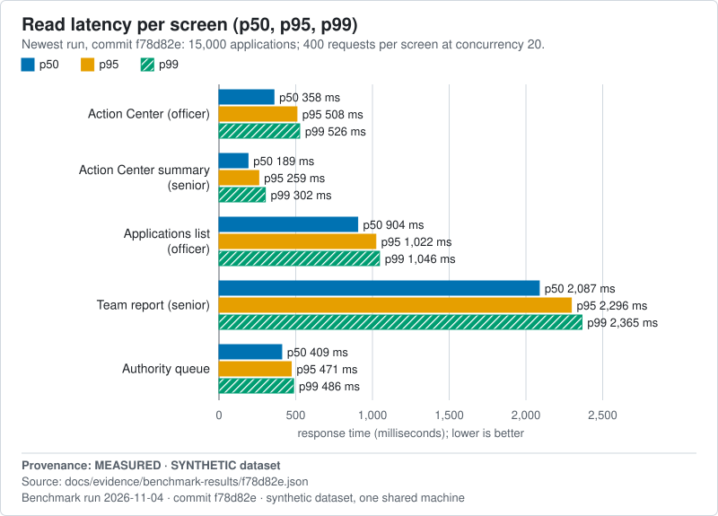
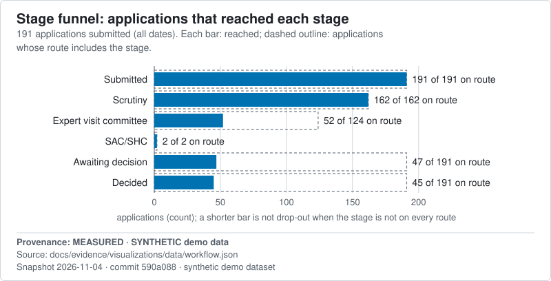
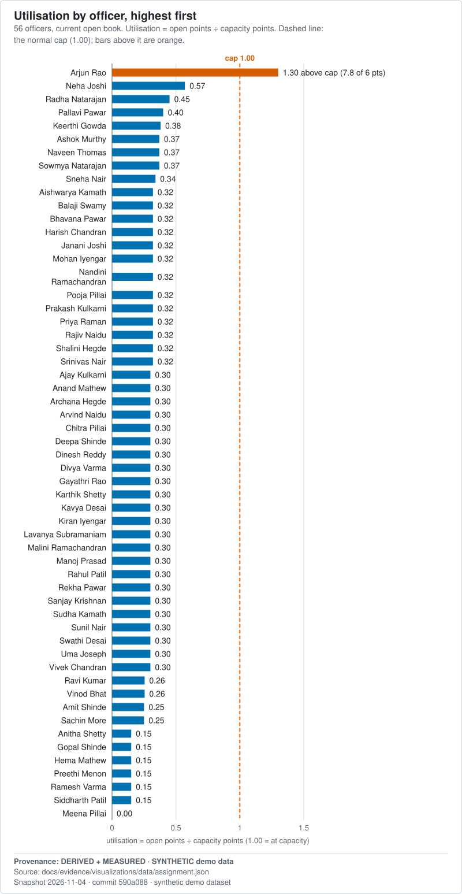
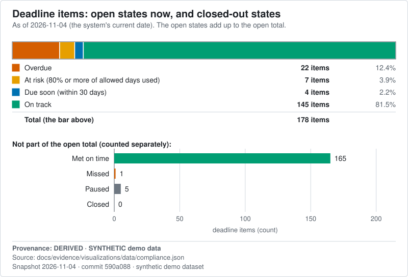
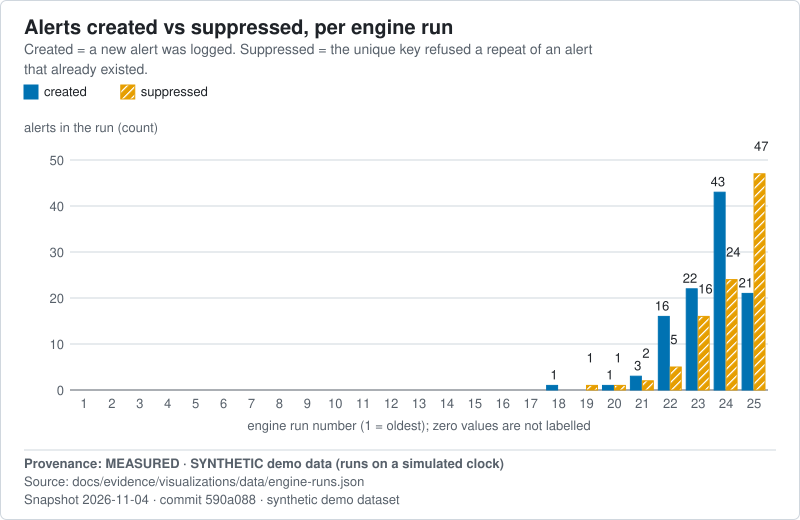
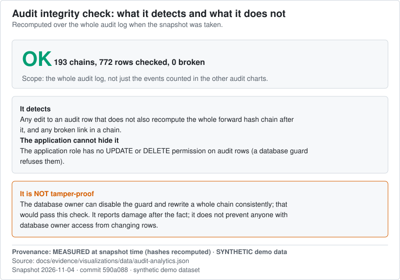
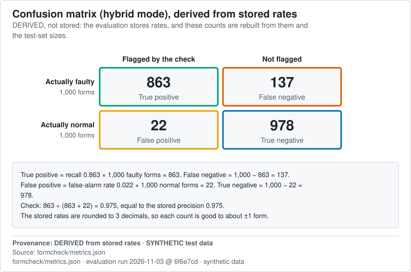
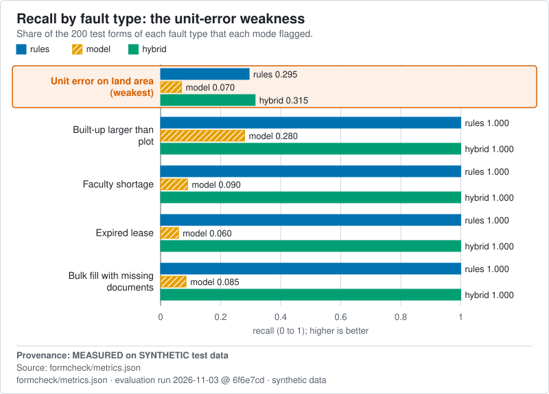

<!-- Generated by `npm run evidence:visualize` from the committed data. Do not edit by hand. -->

# Evidence visualizations

[← Evidence index](../README.md) · [Methodology](METHODOLOGY.md) · [Inventory](INVENTORY.md) · [Architecture diagrams](architecture/README.md)

Charts, graphs and diagrams you can read on GitHub without running anything. Every chart is generated from committed data by one script, shows what kind of figure it is (measured, derived, synthetic), names its source file and the commit it was taken at, and is explained underneath in four parts: what it shows, how it was measured, what you can reasonably conclude and what you cannot.

**Everything here is a synthetic demo dataset** (a seed script plus a simulated clock). Nothing is real AICTE data and nothing claims production readiness. Snapshot 2026-11-04, commit `590a088`; 270 checks, 270 agree against an independent SQL check.

## Key charts

**Read latency per screen (p50, p95, p99).** How fast the API answers on a large synthetic dataset.



**Stage funnel: applications that reached each stage.** Where applications are in the workflow, against the stages on their route.



**Utilisation by officer, highest first.** Officer load against capacity, with the one above-cap officer highlighted.



**Deadline items: open states now, and closed-out states.** Open deadline items by state, adding up to the open total.



**Alerts created vs suppressed, per engine run.** Duplicate alerts refused by the unique key, run by run.



**Audit integrity check: what it detects and what it does not.** What the audit integrity check detects, and what it does not.



**Confusion matrix (hybrid mode), derived from stored rates.** The form check's four outcomes, derived from stored rates.



**Recall by fault type: the unit-error weakness.** Where the form check is weak: unit errors.



## All categories

| Category | Charts | What it covers |
|---|---|---|
| [Benchmarks](benchmarks/README.md) | 7 | Speed and scale of the API and the deadline engine on a larger synthetic dataset. |
| [Workflow](workflow/README.md) | 5 | How applications move through the stages, where they are now, and how long finished ones took. |
| [Assignment](assignment/README.md) | 4 | How review work is spread across officers and what the assignment engine recorded when it decided. |
| [Scheduler and compliance](scheduler-compliance/README.md) | 5 | The state of the deadlines the system tracks and what the deadline engine did on each run. |
| [Alerts and audit](alerts-audit/README.md) | 7 | The alerts the engine logged, the audit trail of actions (counts only, no case content), and exactly what the integrity check does and does not establish.. |
| [Form-check model (ML)](ml/README.md) | 5 | The advisory form-check: a rule set plus an anomaly model. |
| [Architecture](architecture/README.md) | 5 diagrams | System, workflow state machine, assignment flow, deadline engine and the evidence pipeline (Mermaid, drawn by GitHub). |

## Reproduce

```bash
npm run demo:reset        # local demo database only: rebuilds the seeded demo data
npm run evidence:snapshot # verifies API vs independent SQL, then writes docs/evidence/visualizations/data/
npm run evidence:visualize # regenerates every chart and the READMEs under docs/evidence/visualizations/
npm run evidence:verify   # re-runs the API-vs-SQL comparison
```

Details and limits: [METHODOLOGY.md](METHODOLOGY.md).
