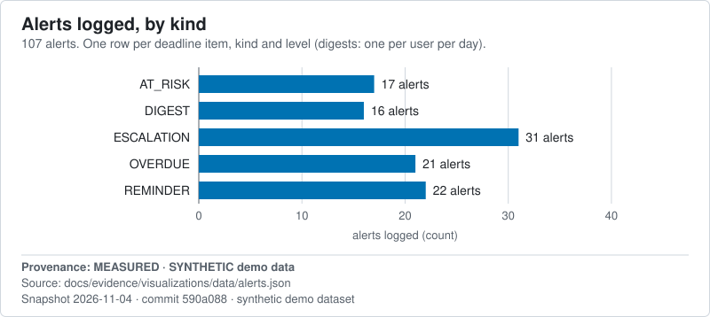
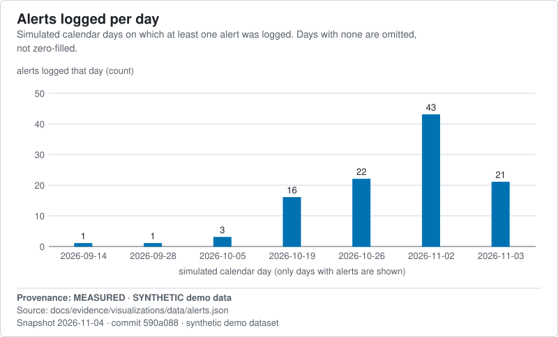
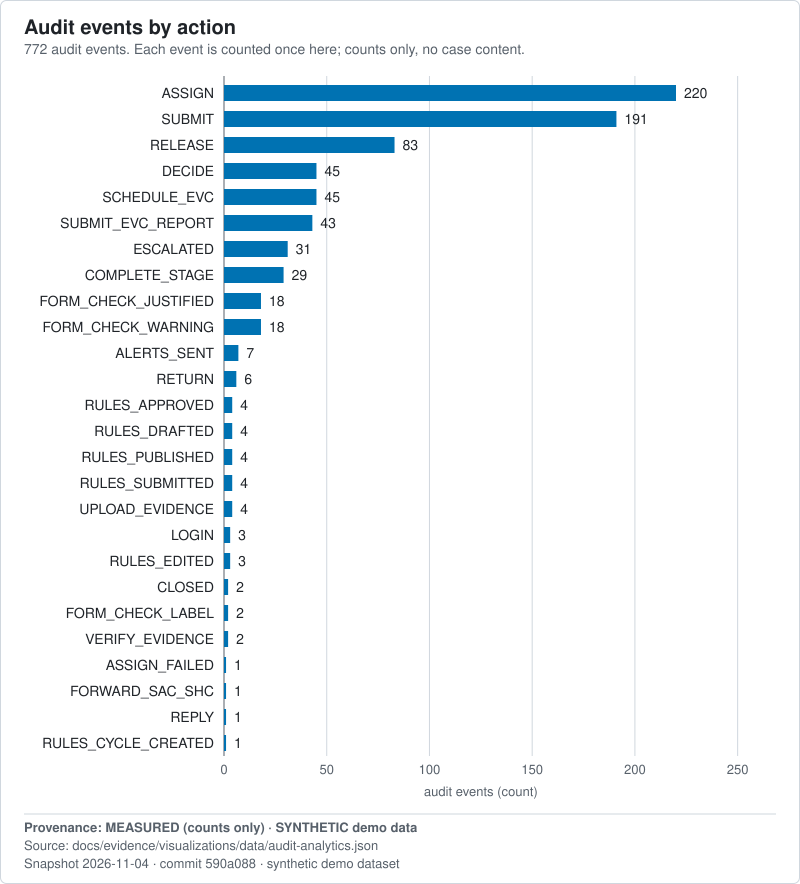
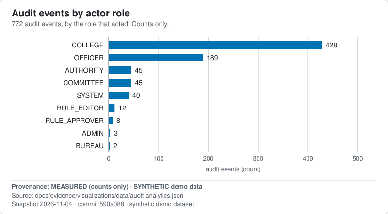
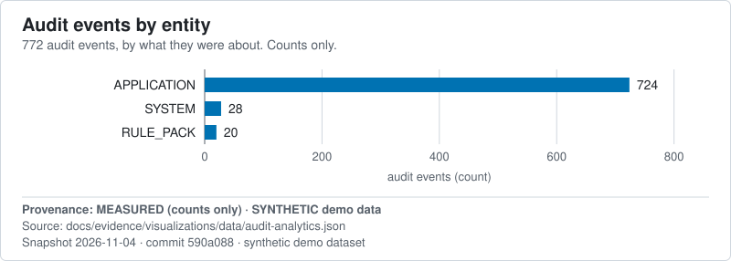
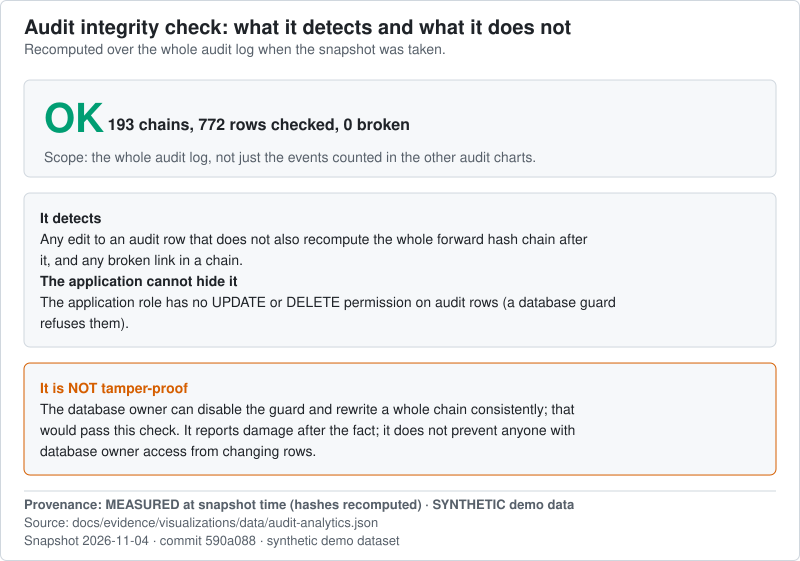
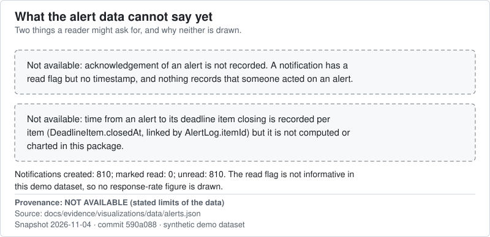

<!-- Generated by `npm run evidence:visualize` from the committed data. Do not edit by hand. -->

# Alerts and audit

[← Evidence visualizations](../README.md) · [Methodology](../METHODOLOGY.md) · [Evidence index](../../README.md)

The alerts the engine logged, the audit trail of actions (counts only, no case content), and exactly what the integrity check does and does not establish.

Snapshot 2026-11-04 at commit `590a088`. All figures are from a synthetic demo dataset.

## Alerts logged, by kind

**What it shows.** The 107 alerts the engine logged, split by kind.

**How it was measured.**

> Number of alerts the deadline engine logged in the window: one row per deadline item, kind and level (daily digests are one row per user per day, not per item), so the same alert is never logged twice. Blank (null) when no engine run and no alert has ever been recorded (engineEverRan is true if either exists, even an alert with no run on file), meaning "none recorded". Otherwise the engine has recorded activity at some time (not necessarily in this window). A total of 0 means no alert was logged in this window. This counts the decision to alert. This build has no external delivery channel, so it says nothing about an alert reaching anyone outside the system.

> Alerts in the window counted by kind (REMINDER, AT_RISK, OVERDUE, ESCALATION, DIGEST). The counts add up to total.

**What you can reasonably conclude.** Which kinds of alert the engine raised in this dataset, and that the kinds add up to the total.

**What you cannot conclude.** Delivery. This build has no external delivery channel, so the count is of decisions to alert, not messages that reached anyone.

Provenance: MEASURED · SYNTHETIC demo data. Source: `docs/evidence/visualizations/data/alerts.json`.

## Alerts logged per day

**What it shows.** Alerts logged on each simulated day on which at least one was logged (7 days).

**How it was measured.**

> Alerts per simulated calendar day, only for days on which at least one alert was logged; days with none are left out, never shown as zero, and nothing is back-filled. The simulated date in this demo can be moved forward, and alerts are only logged when the engine runs, so a missing day usually means the engine did not run on that date, not that no alerts were due. perDay therefore records when the engine ran and is not an operational trend: do not read a rising or falling line as the workload getting better or worse. The counts add up to total.

**What you can reasonably conclude.** On which simulated days the engine logged alerts.

**What you cannot conclude.** That other days were quiet: alerts are only logged when the engine runs, and days with none are absent by design, not zero.

Provenance: MEASURED · SYNTHETIC demo data. Source: `docs/evidence/visualizations/data/alerts.json`.

## Audit events by action

**What it shows.** Count of audit events for each action (26 kinds), out of 772.

**How it was measured.**

> Number of audit-log events matching the filters (From/To on the event time, inclusive; actor = the role that acted; action; entity). Each event is counted once in each of byActorRole, byAction and byEntity, so each breakdown adds up to total. Entity: APPLICATION = an event on a case, RULE_PACK = a rule-pack change, SYSTEM = anything else (sign-ins, clock changes, demo resets). Only counts are returned; no case content is exposed here.

**What you can reasonably conclude.** What kinds of activity the system recorded, for instance that every submission and every assignment has an audit event.

**What you cannot conclude.** The content of any event, or who the individuals were. Only counts are exposed. The events come from seeded and simulated activity, not from real use.

Provenance: MEASURED (counts only) · SYNTHETIC demo data. Source: `docs/evidence/visualizations/data/audit-analytics.json`.

## Audit events by actor role

**What it shows.** Count of audit events by the role that acted, out of 772.

**How it was measured.**

> Number of audit-log events matching the filters (From/To on the event time, inclusive; actor = the role that acted; action; entity). Each event is counted once in each of byActorRole, byAction and byEntity, so each breakdown adds up to total. Entity: APPLICATION = an event on a case, RULE_PACK = a rule-pack change, SYSTEM = anything else (sign-ins, clock changes, demo resets). Only counts are returned; no case content is exposed here.

**What you can reasonably conclude.** Which roles are recorded as acting in this dataset.

**What you cannot conclude.** Workload per person or any judgement of performance: it counts events by role, and the seed script produced most of them.

Provenance: MEASURED (counts only) · SYNTHETIC demo data. Source: `docs/evidence/visualizations/data/audit-analytics.json`.

## Audit events by entity

**What it shows.** Count of audit events by what they were about: a case (APPLICATION), a rule-pack change (RULE_PACK) or anything else (SYSTEM), out of 772.

**How it was measured.**

> Number of audit-log events matching the filters (From/To on the event time, inclusive; actor = the role that acted; action; entity). Each event is counted once in each of byActorRole, byAction and byEntity, so each breakdown adds up to total. Entity: APPLICATION = an event on a case, RULE_PACK = a rule-pack change, SYSTEM = anything else (sign-ins, clock changes, demo resets). Only counts are returned; no case content is exposed here.

**What you can reasonably conclude.** That rule-pack changes are audited separately from case actions.

**What you cannot conclude.** Anything about the individual changes themselves.

Provenance: MEASURED (counts only) · SYNTHETIC demo data. Source: `docs/evidence/visualizations/data/audit-analytics.json`.

## Audit integrity check: what it detects and what it does not

**What it shows.** The result of recomputing the audit hash chains over the whole log when the snapshot was taken: no break found in 193 chains and 772 rows.

**How it was measured.**

> Recomputed now over the WHOLE audit log, not just the filtered events: each chain's hashes are re-derived and compared with the stored links, so an edited event or a broken link in a chain is reported. ok = no chain failed. It reports damage after the fact; it does not prevent anyone with database access from changing rows.

**What you can reasonably conclude.** No audit row in this database was edited or removed in a way that leaves the chain inconsistent, and the application's own database role is refused UPDATE and DELETE on audit rows.

**What you cannot conclude.** That the log is tamper-proof. A database owner can disable the guard and rewrite a whole chain consistently, and the check would still pass. It detects damage after the fact; it does not prevent it. It also says nothing about whether the recorded events are true.

Provenance: MEASURED at snapshot time (hashes recomputed) · SYNTHETIC demo data. Source: `docs/evidence/visualizations/data/audit-analytics.json`.

## What the alert data cannot say yet

**What it shows.** Two questions about alerts that the data cannot answer, and the notification read counts that explain why no response figure is drawn.

**How it was measured.**

`notRecorded`: acknowledgement. `notComputed`: time from alert to deadline item closing. Both are reported by the Evidence API itself rather than inferred here.

**What you can reasonably conclude.** What is missing, so nobody mistakes a blank for a good result.

**What you cannot conclude.** Whether any alert led to action. Acknowledgement is not recorded, and the time from an alert to its deadline item closing is stored per item but not computed in this package.

Provenance: NOT AVAILABLE (stated limits of the data). Source: `docs/evidence/visualizations/data/alerts.json`.

---

[← Evidence visualizations](../README.md)
