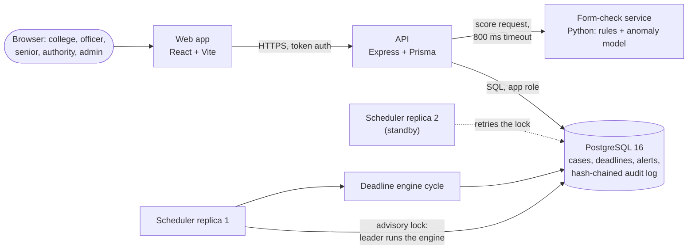
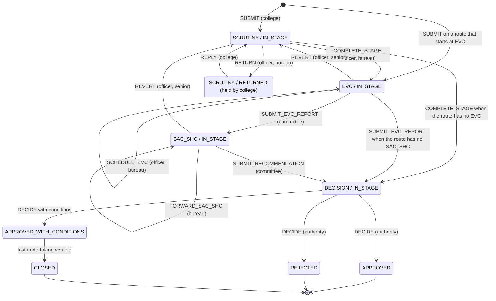
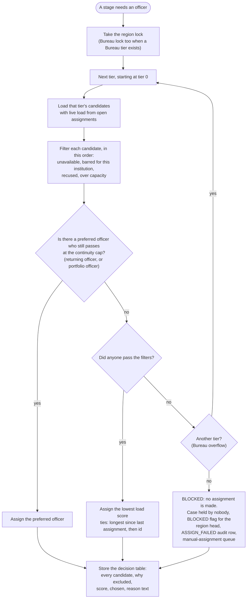
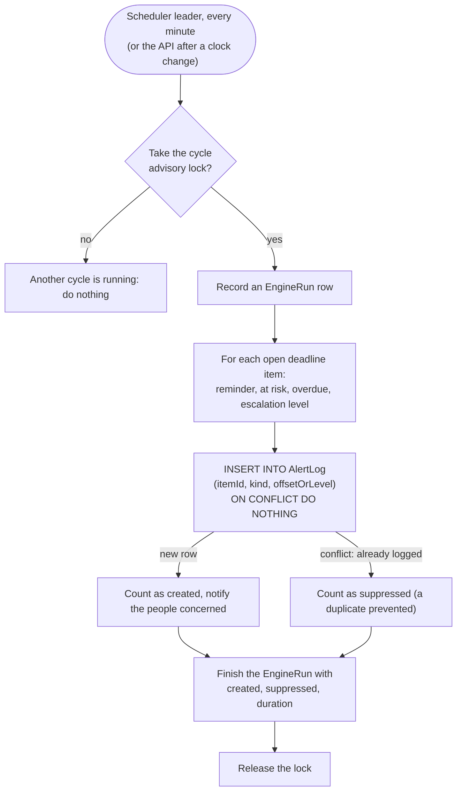
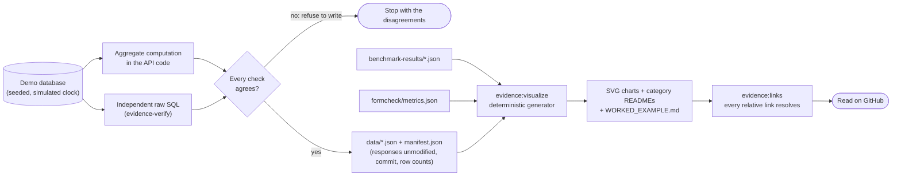

# Architecture diagrams

[← Evidence visualizations](../README.md) · [Methodology](../METHODOLOGY.md)

Five diagrams, drawn by GitHub from the Mermaid below. Each one is derived from the code it cites, not from how such systems are usually built, and each lists what it leaves out. The existing [workflow diagrams](../../WORKFLOW.md) (case lifecycle, assignment decision, escalation ladder, rule-pack publish) are linked rather than repeated.

## System architecture

**Source:** [`docker-compose.yml`](../../../../docker-compose.yml), [`api/src/app.ts`](../../../../api/src/app.ts), [`api/src/scheduler.ts`](../../../../api/src/scheduler.ts), [`formcheck/app/main.py`](../../../../formcheck/app/main.py), and the hosted-variant table in the [root README](../../../../README.md#live-demo-vercel--neon).

Leaves out: the rule-pack versioning flow, file storage and the Hindi/English interface layer. In the hosted variant the API is one serverless function and the engine runs after requests and from a daily cron instead of two scheduler processes. There is no external alert delivery channel in this build.

## Application workflow state machine

**Source:** the `TRANSITIONS` table in [`api/src/workflow/transitions.ts`](../../../../api/src/workflow/transitions.ts) (actions, roles, from-states), the handlers in [`api/src/workflow/actions.ts`](../../../../api/src/workflow/actions.ts) (what each action writes), and the stage and status enums in [`api/prisma/schema.prisma`](../../../../api/prisma/schema.prisma). Per-case permission checks are in `api/src/policy/can.ts`.

Reading notes:
- Stage order is the case's stored `route`, resolved from the rule pack when the case is filed. `COMPLETE_STAGE`, `SUBMIT_EVC_REPORT` and `SUBMIT_RECOMMENDATION` move to the next stage on that route, so a route need not include every stage; the diagram draws the two shortcuts the recorded data actually shows ([transition counts](../workflow/README.md#recorded-stage-and-status-changes-by-action)).
- `SCHEDULE_EVC` and `FORWARD_SAC_SHC` do not change stage: they change who holds the case (the committee) within the stage.
- `CLOSED` is reached from an approval with conditions when every undertaking is verified (`actions.ts`, the verification handler).
- Only `DECIDE` approves or rejects, and only for the authority role.

## Assignment decision flow

**Source:** [`api/src/assignment/engine.ts`](../../../../api/src/assignment/engine.ts): `selectOfficer` (tier loop, continuity preference, score), `filterCandidates` (exclusions), `byScore` (tie-break) and `assign` (the blocked branch). A worked example with real stored decisions: [`WORKED_EXAMPLE.md`](../assignment/WORKED_EXAMPLE.md).

Leaves out: the urgent-task cap (a higher ceiling for urgent tasks), and the score weights, which come from the rule pack. A later tier assigned to a Bureau officer is recorded as `BUREAU_OVERFLOW`. Manual assignments and reassignments bypass this flow and write no decision table.

## Deadline engine cycle and alert idempotency

**Source:** [`api/src/engine/cycle.ts`](../../../../api/src/engine/cycle.ts) (`alertOnce`, the cycle and its advisory lock), [`api/src/scheduler.ts`](../../../../api/src/scheduler.ts), and the `@@unique([itemId, kind, offsetOrLevel])` constraint on `AlertLog` in [`schema.prisma`](../../../../api/prisma/schema.prisma). The [escalation ladder](../../WORKFLOW.md#3-escalation-ladder) is drawn separately.

What it establishes: the decision to alert is made at most once per item, kind and level, enforced by a database unique key and not by the engine remembering. What it does not: delivery. There is no external channel, so "exactly once" applies to the logged decision only. The suppressed counter is what the [duplicate-prevention charts](../benchmarks/README.md#duplicate-alert-prevention-created-vs-suppressed) plot.

## Evidence generation pipeline

**Source:** [`api/scripts/snapshot-evidence.ts`](../../../../api/scripts/snapshot-evidence.ts), [`api/src/evidence-verify.ts`](../../../../api/src/evidence-verify.ts), [`scripts/evidence-visualizations.mjs`](../../../../scripts/evidence-visualizations.mjs), [`scripts/check-doc-links.mjs`](../../../../scripts/check-doc-links.mjs).

Leaves out: how the benchmark and the ML evaluation files are produced (`npm run load:test`, `python3 -m training.evaluate`); both are committed inputs. Regenerating with unchanged inputs gives byte-identical files.
