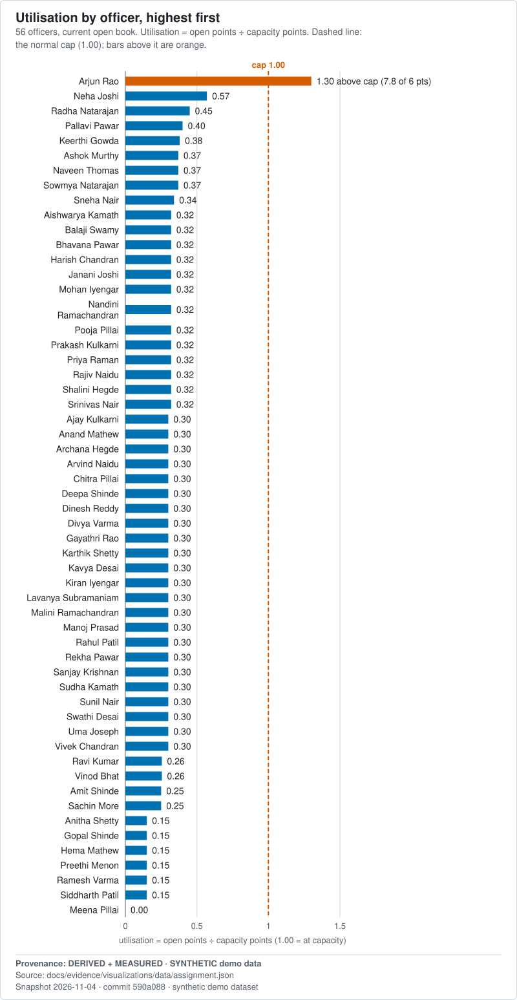
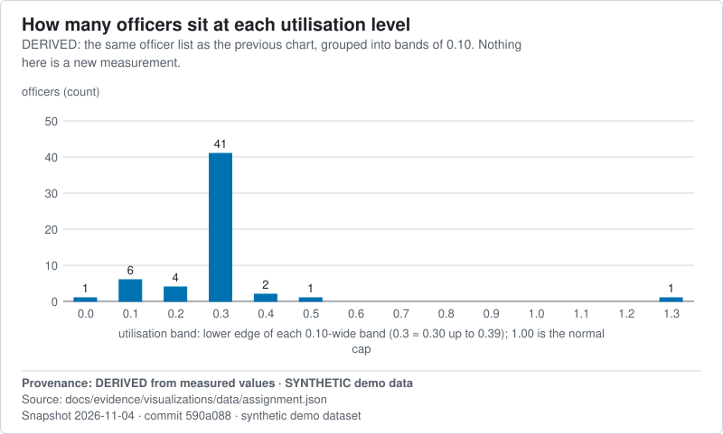
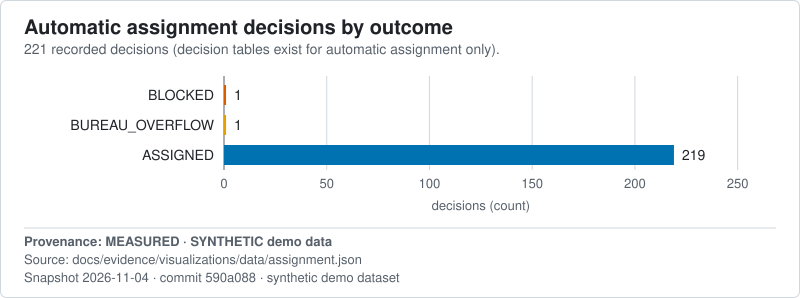
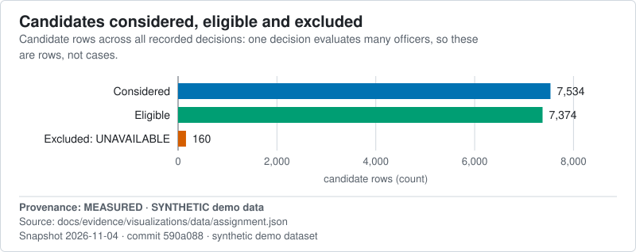

<!-- Generated by `npm run evidence:visualize` from the committed data. Do not edit by hand. -->

# Assignment

[← Evidence visualizations](../README.md) · [Methodology](../METHODOLOGY.md) · [Evidence index](../../README.md)

How review work is spread across officers and what the assignment engine recorded when it decided. The decision tables exist for automatic assignment only. A step-by-step example is in [`WORKED_EXAMPLE.md`](WORKED_EXAMPLE.md).

Snapshot 2026-11-04 at commit `590a088`. All figures are from a synthetic demo dataset.

## Utilisation by officer, highest first

**What it shows.** Each of the 56 officers' current load as a share of their capacity, highest first, with the normal cap as a dashed line. 1 officer is above the cap and drawn in orange: Arjun Rao (1.30).

**How it was measured.**

> Only users with the OFFICER role are listed (committee and bureau profiles are excluded). Per officer: capacityPoints (configured capacity), openPoints (sum of the weight of all their open, unreleased assignments, now) and utilisation = openPoints / capacityPoints, DERIVED from those two measured values. openPointsAssignedInWindow is the part of openPoints from assignments made in the From/To window.

Spread across officers: mean 0.31, standard deviation 0.16 over 56 officers.

**What you can reasonably conclude.** 1 of 56 officers are above the cap; the other 55 are at or below it (highest of those: 0.57). The stored explanation for an above-cap officer is quoted verbatim in the worked example.

**What you cannot conclude.** That the distribution is correct or ideal: the aggregate's own definition says it "describes how load is spread, not whether it is right" and that "equal counts are not the goal". Capacity is a configured number, not observed effort. Nothing here shows the quality or speed of an officer's work.

Provenance: DERIVED + MEASURED · SYNTHETIC demo data. Source: `docs/evidence/visualizations/data/assignment.json`.

## How many officers sit at each utilisation level

**What it shows.** How many officers fall into each 0.10-wide band of utilisation.

**How it was measured.**

Derived from the same officer list as the previous chart; each officer is placed in the band containing their utilisation. No separate query was run. Band 0.3 means 0.30 up to 0.39.

**What you can reasonably conclude.** The shape of the spread across bands, read from the bars and their counts.

**What you cannot conclude.** Anything the previous chart does not already say: this is the same data re-grouped, so it is not independent evidence.

Provenance: DERIVED from measured values · SYNTHETIC demo data. Source: `docs/evidence/visualizations/data/assignment.json`.

## Automatic assignment decisions by outcome

**What it shows.** How many automatic assignment decisions ended in each outcome: assigned, assigned through Bureau overflow, or blocked (no eligible officer).

**How it was measured.**

> tracedCount / assignmentTotal: assignments made in the window that have a recorded decision table (trace), over all assignments made in the window. Traces are written when the engine assigns automatically; a manual assignment or manual reassignment writes none, so coverage is partial and a case without a trace is not an error. blockedCount is decisions where no officer could be assigned (no assignment exists for them).

> Over decisions recorded in the window: candidatesConsidered = officers evaluated across all decisions; eligible = those eligible; excluded counts the stated reason. A decision evaluates several officers, so these are candidate rows, not cases.

**What you can reasonably conclude.** The engine recorded 220 decisions covering 220 assignments; 1 decision could not assign anyone and was left visibly blocked for a person.

**What you cannot conclude.** That every assignment has a decision table: manual assignments and reassignments write none. It also says nothing about whether an assignment was a good match.

Provenance: MEASURED · SYNTHETIC demo data. Source: `docs/evidence/visualizations/data/assignment.json`.

## Candidates considered, eligible and excluded

**What it shows.** Across all recorded decisions: 7,534 candidate rows were evaluated, 7,374 were eligible and 160 were excluded as UNAVAILABLE.

**How it was measured.**

> Over decisions recorded in the window: candidatesConsidered = officers evaluated across all decisions; eligible = those eligible; excluded counts the stated reason. A decision evaluates several officers, so these are candidate rows, not cases.

**What you can reasonably conclude.** The engine records why a candidate was set aside, not only who won, so an exclusion can be traced to a stated reason.

**What you cannot conclude.** The number of distinct officers affected: one officer appears once per decision. These are candidate rows, not cases or people.

Provenance: MEASURED · SYNTHETIC demo data. Source: `docs/evidence/visualizations/data/assignment.json`.

---

[← Evidence visualizations](../README.md)
