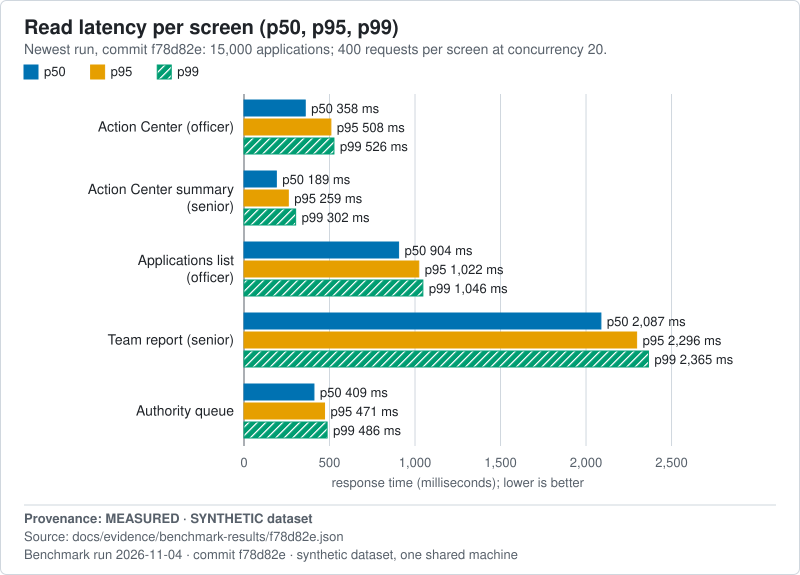
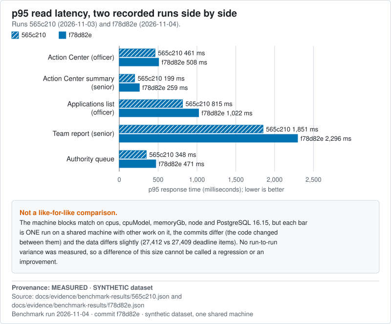
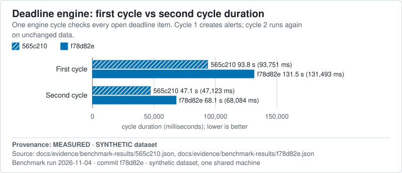
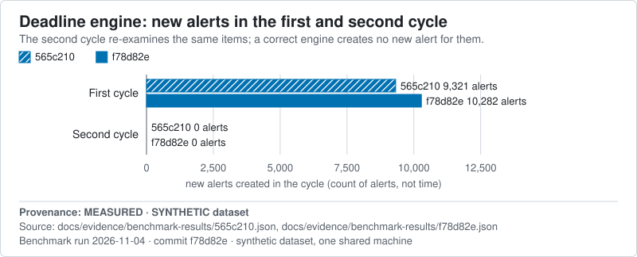
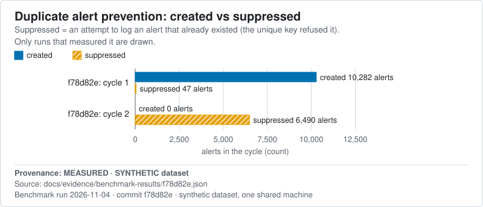
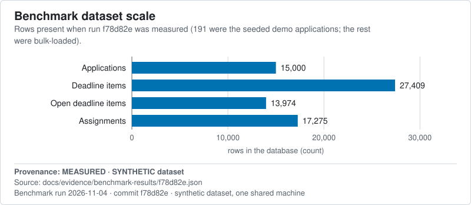
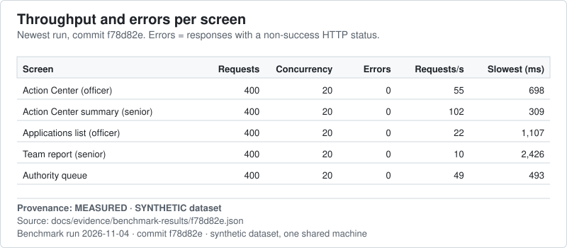

<!-- Generated by `npm run evidence:visualize` from the committed data. Do not edit by hand. -->

# Benchmarks

[← Evidence visualizations](../README.md) · [Methodology](../METHODOLOGY.md) · [Evidence index](../../README.md)

Speed and scale of the API and the deadline engine on a larger synthetic dataset. Two single recorded runs on one shared machine; the benchmark is not a capacity guarantee. Full tables and method: [`BENCHMARKS.md`](../../BENCHMARKS.md).

Snapshot 2026-11-04 at commit `590a088`. All figures are from a synthetic demo dataset.

## Read latency per screen (p50, p95, p99)

**What it shows.** For each of the 5 screens that were load-tested, the median (p50), 95th-percentile (p95) and 99th-percentile (p99) response time of the API, from the newest recorded run (commit `f78d82e`).

**How it was measured.**

400 requests per screen at a concurrency of 20, from `npm run load:test`, against 15,000 applications in PostgreSQL 16.15. Percentiles are read off the sorted request times of each screen. Errors: 0 across all screens. Source: `docs/evidence/benchmark-results/f78d82e.json`.

**What you can reasonably conclude.** On this machine and dataset the slowest screen at p95 was "Team report (senior)" at 2,296 ms, and the fastest p95 was 259 ms. The spread between p50 and p99 shows how much latency varied under 20 parallel requests.

**What you cannot conclude.** Anything about a production deployment, a different machine, a different number of concurrent users, or a different data size. One run per commit was taken, so there is no estimate of run-to-run variance.

Provenance: MEASURED · SYNTHETIC dataset. Source: `docs/evidence/benchmark-results/f78d82e.json`.

## p95 read latency, two recorded runs side by side

**What it shows.** The p95 response time of each screen in the two recorded runs, drawn side by side, only when the two runs were taken on matching machines.

**How it was measured.**

The machine blocks of `docs/evidence/benchmark-results/565c210.json` and `docs/evidence/benchmark-results/f78d82e.json` are compared on cpus, cpuModel, memoryGb, node and pgVersion. The chart is drawn only if they all match; otherwise it shows a "Not available" panel naming what differs.

**What you can reasonably conclude.** Whether the two recorded runs agree to within the size of a single-run difference, on the same machine specification.

**What you cannot conclude.** That the later run is slower or faster in any lasting sense. It is not a like-for-like comparison: the code changed between the two commits, the data differs slightly, each bar is one run on a shared machine, and no variance was measured.

Provenance: MEASURED · SYNTHETIC dataset. Source: `docs/evidence/benchmark-results/565c210.json and docs/evidence/benchmark-results/f78d82e.json`.

## Deadline engine: first cycle vs second cycle duration

**What it shows.** How long the deadline engine took for its first and its second full cycle, in each recorded run.

**How it was measured.**

Wall-clock milliseconds around each full engine cycle in `npm run load:test`. The first cycle starts with no alerts logged; the second repeats on unchanged data. In the newest run the cycle checked 13,974 open items. Source: `docs/evidence/benchmark-results/f78d82e.json`.

**What you can reasonably conclude.** At 15,000 applications a full engine cycle took 131 s (first) and 68 s (second) in the newest run.

**What you cannot conclude.** That this is acceptable for AICTE's real volume, or that the engine scales linearly. Neither run measured resource use (memory, CPU) and each duration is a single sample.

Provenance: MEASURED · SYNTHETIC dataset. Source: `docs/evidence/benchmark-results/565c210.json, docs/evidence/benchmark-results/f78d82e.json`.

## Deadline engine: new alerts in the first and second cycle

**What it shows.** How many new alerts the first and the second engine cycle created, per recorded run.

**How it was measured.**

`newAlerts` counted from the engine's own return value in each cycle (alerts newly logged, not time). Source: `docs/evidence/benchmark-results/f78d82e.json` and the older run file.

**What you can reasonably conclude.** The second cycle over the same data created 0 new alerts in the newest run: re-running the engine did not re-raise alerts that already existed.

**What you cannot conclude.** That the engine would behave the same on data that changes between cycles, or that any alert was delivered to a person (this build has no external delivery channel).

Provenance: MEASURED · SYNTHETIC dataset. Source: `docs/evidence/benchmark-results/565c210.json, docs/evidence/benchmark-results/f78d82e.json`.

## Duplicate alert prevention: created vs suppressed

**What it shows.** For each run that measured it: alerts created and alerts suppressed in cycle 1 and cycle 2. Suppressed means the database refused to log an alert that was already there.

**How it was measured.**

`alertsSuppressed` is the number of insert attempts that hit `ON CONFLICT DO NOTHING` on the alert log's unique key (item, kind, level). Runs recorded before 2026-11-04 did not measure it and are not drawn. Newest run: cycle 1 created 10,282 and suppressed 47; cycle 2 created 0 and suppressed 6,490.

**What you can reasonably conclude.** Repeating the cycle produced attempted duplicates and every one was refused by the unique key, which is the mechanism that makes "decide to alert once" hold.

**What you cannot conclude.** Exactly-once delivery to a person: there is no external channel in this build, so only the decision to alert is protected. It also does not show behaviour under two engines racing, which was not benchmarked.

Provenance: MEASURED · SYNTHETIC dataset. Source: `docs/evidence/benchmark-results/f78d82e.json`.

## Benchmark dataset scale

**What it shows.** How much data the benchmark ran against: applications, deadline items (and how many were open) and assignments.

**How it was measured.**

Row counts read from the database immediately after the bulk load in `docs/evidence/benchmark-results/f78d82e.json` (bulk load took 1,854 ms). 191 of the applications are the seeded demo applications; the rest are generated.

**What you can reasonably conclude.** The latency and engine figures were taken at about 79 times as many applications as the seeded demo database holds.

**What you cannot conclude.** That the generated data has the shape of real applications. It is uniform synthetic data, so skew in real data (a few very busy officers or colleges) is not represented.

Provenance: MEASURED · SYNTHETIC dataset. Source: `docs/evidence/benchmark-results/f78d82e.json`.

## Throughput and errors per screen

**What it shows.** Per screen: how many requests were sent, at what concurrency, how many failed, requests per second and the slowest single request.

**How it was measured.**

From the same load test as the latency chart (`docs/evidence/benchmark-results/f78d82e.json`). An error is a response with a non-success HTTP status. Requests per second is requests divided by the wall-clock time of that screen's test. The load generator and the API ran on the same machine.

**What you can reasonably conclude.** No request failed in any of the 5 screens (0 errors in 2,000 requests).

**What you cannot conclude.** That the system is free of errors under other load patterns, longer runs or mixed read/write traffic. The test is reads only, 400 requests per screen.

Provenance: MEASURED · SYNTHETIC dataset. Source: `docs/evidence/benchmark-results/f78d82e.json`.

---

[← Evidence visualizations](../README.md)
