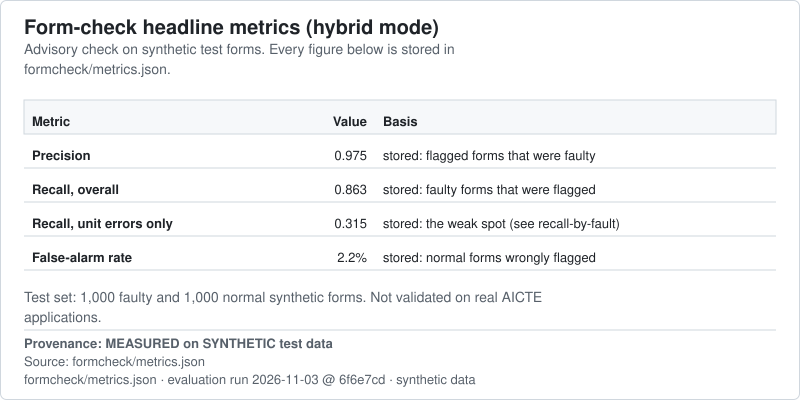
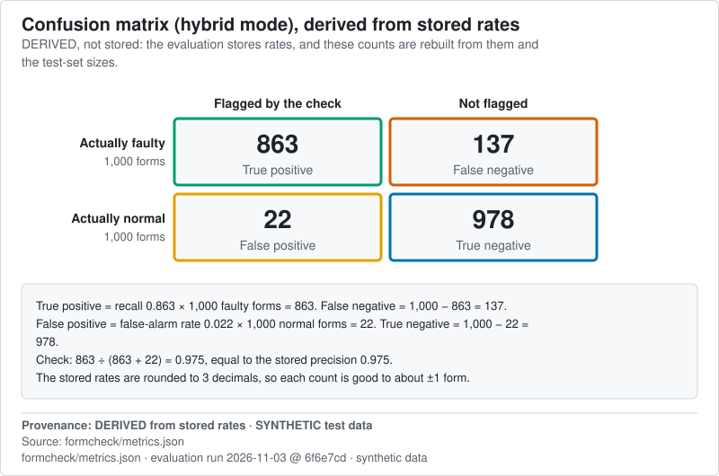
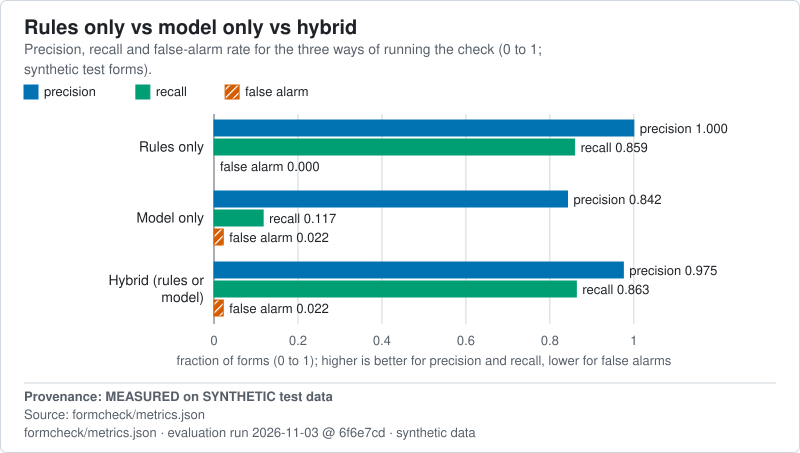
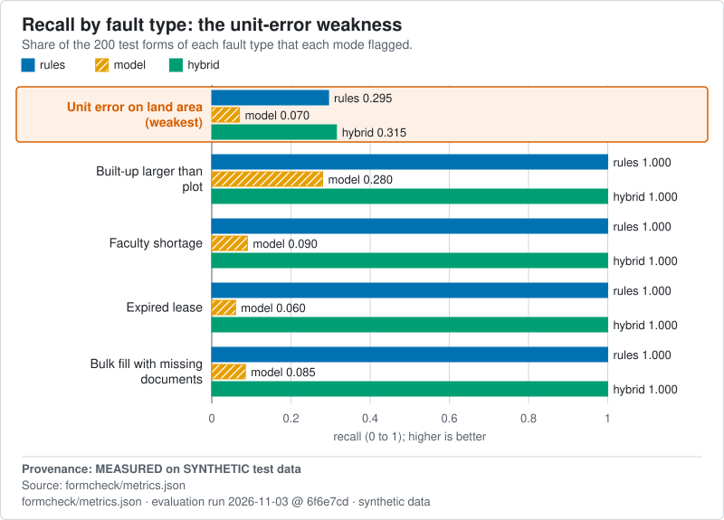
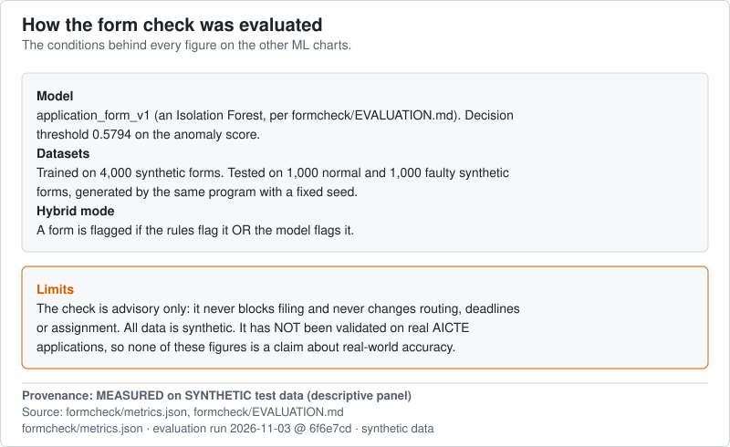

<!-- Generated by `npm run evidence:visualize` from the committed data. Do not edit by hand. -->

# Form-check model (ML)

[← Evidence visualizations](../README.md) · [Methodology](../METHODOLOGY.md) · [Evidence index](../../README.md)

The advisory form-check: a rule set plus an anomaly model. Every figure is measured on synthetic data. There is no claim about real AICTE applications.

Snapshot 2026-11-04 at commit `590a088`. All figures are from a synthetic demo dataset.

## Form-check headline metrics (hybrid mode)

**What it shows.** The four headline numbers of the form check in hybrid mode: precision 0.975, overall recall 0.863, recall on unit errors 0.315 and false-alarm rate 2.2%.

**How it was measured.**

Stored by `python3 -m training.evaluate` in `formcheck/metrics.json` (evaluation run 2026-11-03). The hybrid flags a form if the rules or the model flags it. Test forms: 1,000 faulty (200 per fault type) and 1,000 normal. All four are stored values, not derived here.

**What you can reasonably conclude.** On the synthetic test forms the hybrid check flagged most faulty forms with a small false-alarm rate, and flagged few unit errors.

**What you cannot conclude.** How well it would do on real AICTE applications. The forms are synthetic, generated by the same program that produced the training data, and the faults are the ones we wrote. No real-world accuracy claim is made.

Provenance: MEASURED on SYNTHETIC test data. Source: `formcheck/metrics.json`.

## Confusion matrix (hybrid mode), derived from stored rates

**What it shows.** The four outcomes of the hybrid check on the test forms: faulty forms flagged and missed, normal forms flagged and passed.

**How it was measured.**

DERIVED: the evaluation stores rates, not counts. True positives = recall 0.863 × 1,000 faulty forms; false positives = false-alarm rate 0.022 × 1,000 normal forms; the other two cells are the remainders. The chart re-derives precision from these counts and compares it with the stored value.

**What you can reasonably conclude.** The stored rates are consistent with one 2×2 table of counts, and the chart checks that its precision equals the stored precision.

**What you cannot conclude.** That these are the true counts: they are rebuilt from rates rounded to three decimals and are good to about one form. The matrix is also not evidence of real-world performance.

Provenance: DERIVED from stored rates · SYNTHETIC test data. Source: `formcheck/metrics.json`.

## Rules only vs model only vs hybrid

**What it shows.** Rules only, model only and the hybrid, each with precision, recall and false-alarm rate.

**How it was measured.**

All nine values are stored in `formcheck/metrics.json`. Rules only never flags a normal form (false-alarm rate 0.000) but misses what its rules were not written for; the model alone finds few faults; the hybrid takes the rules' recall and adds a small false-alarm rate from the model.

**What you can reasonably conclude.** Hybrid recall 0.863 against 0.859 for rules only, at a false-alarm rate of 2.2% against 0.0%.

**What you cannot conclude.** That the model earns its place on real data. On these synthetic forms its added recall is small, and the comparison is against the rules we wrote ourselves.

Provenance: MEASURED on SYNTHETIC test data. Source: `formcheck/metrics.json`.

## Recall by fault type: the unit-error weakness

**What it shows.** Recall for each of the five fault types in each mode. Unit errors on land area are highlighted: the hybrid caught 0.315 of them (rules 0.295, model 0.070).

**How it was measured.**

Stored in `formcheck/metrics.json` under `perFault`: 200 synthetic test forms per fault type, and the share each mode flagged.

**What you can reasonably conclude.** Recall is 1.000 on the four fault types the rules describe and low on unit errors, where the built-up area stays below the plot area so no rule fires (per formcheck/EVALUATION.md). The weakness is shown, not hidden.

**What you cannot conclude.** That a unit error would be caught on a real form, or that other fault types we did not simulate would be. 200 forms per type is a small sample and the faults are synthetic.

Provenance: MEASURED on SYNTHETIC test data. Source: `formcheck/metrics.json`.

## How the form check was evaluated

**What it shows.** The conditions under which every ML figure was produced: model, threshold, dataset sizes and the limits.

**How it was measured.**

Read from `formcheck/metrics.json` (model application_form_v1, threshold 0.5794, datasets) and `formcheck/EVALUATION.md` (model type).

**What you can reasonably conclude.** How to reproduce the figures and what they were measured on.

**What you cannot conclude.** Anything beyond synthetic data. The check is advisory: it never blocks filing, and it has not been validated on real AICTE applications.

Provenance: MEASURED on SYNTHETIC test data (descriptive panel). Source: `formcheck/metrics.json, formcheck/EVALUATION.md`.

---

[← Evidence visualizations](../README.md)
