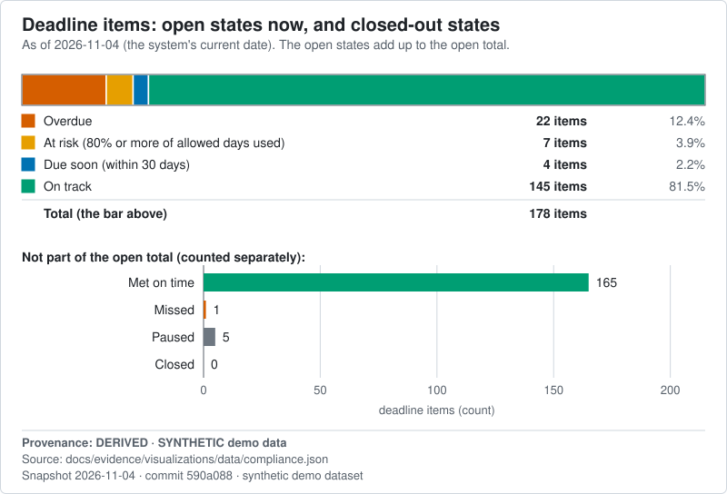
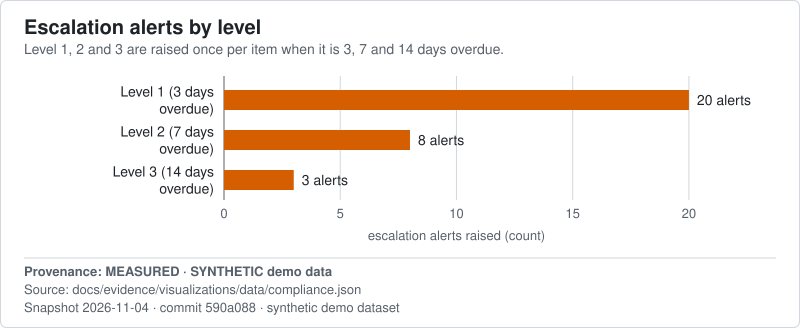
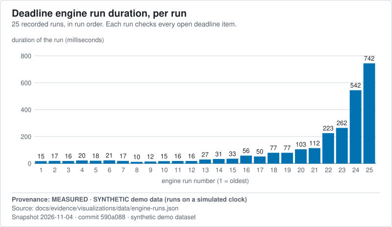
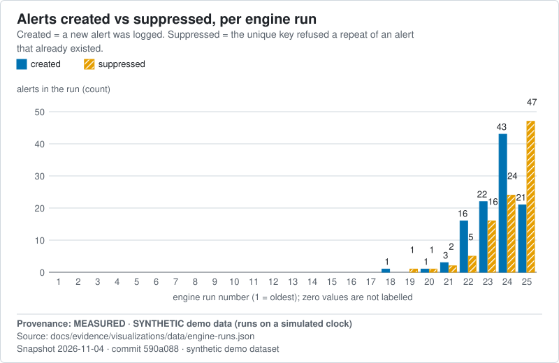
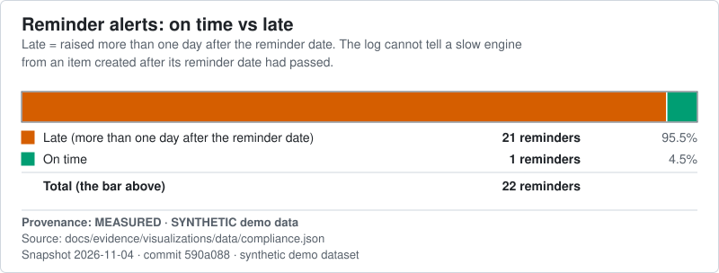

<!-- Generated by `npm run evidence:visualize` from the committed data. Do not edit by hand. -->

# Scheduler and compliance

[← Evidence visualizations](../README.md) · [Methodology](../METHODOLOGY.md) · [Evidence index](../../README.md)

The state of the deadlines the system tracks and what the deadline engine did on each run. The engine ran on a simulated clock in this demo, so run dates are simulated.

Snapshot 2026-11-04 at commit `590a088`. All figures are from a synthetic demo dataset.

## Deadline items: open states now, and closed-out states

**What it shows.** Of 178 open deadline items as of 2026-11-04: 22 overdue, 7 at risk, 4 due soon and 145 on track. Below it, items already closed out: 165 met, 1 missed, 5 paused, 0 closed.

**How it was measured.**

> Evaluated on the system's current date (2026-11-04), the same date the deadline engine uses. Denominator for every state: openTotal, the open (not paused, met, missed or closed) deadline items due in the window; the four states add up to it.

> Open item whose due date has passed: days remaining < 0, counted in working days for stage deadlines (weekends and holidays skipped) and calendar days for undertakings and document expiries. This is the engine's own test for raising an overdue alert.

> Open stage-type item (stage, EVC scheduling, EVC report, evidence verification) not yet overdue where the share of its allowed working days already used is at least 80% (the at-risk threshold in rule pack 2027-28 v1). Used = (allowed days - days remaining) / allowed days. Same test as the engine's at-risk alert.

> Open undertaking or document-expiry item, not overdue, that is within 30 calendar days of its due date (the earliest reminder point in rule pack 2027-28 v1).

> Open items that are none of the above.

**What you can reasonably conclude.** How the open deadlines divide by the engine's own tests on the system's current date.

**What you cannot conclude.** A compliance rate for real institutions or AICTE officers: the dates come from a simulated clock and seeded items. The at-risk/due-soon/on-track split is derived from rule-pack thresholds, so it moves if those thresholds change.

Provenance: DERIVED · SYNTHETIC demo data. Source: `docs/evidence/visualizations/data/compliance.json`.

## Escalation alerts by level

**What it shows.** How many escalation alerts were raised at each level.

**How it was measured.**

> Escalation alerts raised in the window, by level; empty (not zero at each level) when the engine has never run and no alert has ever been recorded. Level 1, 2 and 3 are raised when an item is 3 / 7 / 14 days overdue (working days for stage deadlines, calendar days for undertakings and document expiries). Each level is raised once per item.

**What you can reasonably conclude.** level 1: 20, level 2: 8, level 3: 3. A level is raised only once an item has stayed overdue long enough, so the counts can only fall as the level rises if items are resolved in between.

**What you cannot conclude.** That anyone acted on an escalation: the system records the decision to alert, and acknowledgement is not recorded.

Provenance: MEASURED · SYNTHETIC demo data. Source: `docs/evidence/visualizations/data/compliance.json`.

## Deadline engine run duration, per run

**What it shows.** The duration of each of the 25 recorded engine runs, in run order.

**How it was measured.**

> One row per recorded engine cycle in the window, newest first, paged. Each row shows what that cycle checked, created and suppressed, and how it ended. Provenance on a row says how it was produced: TEST_RUN (automated tests), BENCHMARK (load test), SIMULATED (run on a pinned or moved clock, or run by the seed script even though the seed's last cycle uses the real clock), LIVE_DEMO (run on the real clock by something other than the seed, tests or a load test). If more than one applies, TEST_RUN outranks BENCHMARK, which outranks SIMULATED, which outranks LIVE_DEMO.

> Counted over every run in the window and status filter, in one query, not from the page shown: runCount = runs; failedCount = runs that ended FAILED. alertsCreated and alertsSuppressed are blank (not 0) when no run is recorded in the window, because then nothing was measured.

**What you can reasonably conclude.** Slowest recorded run: 742 ms; fastest: 10 ms; 0 failed.

**What you cannot conclude.** Production run time: each bar is the duration of one run on this machine's database, with runs executed on a simulated clock in quick succession. It is not a service-level figure.

Provenance: MEASURED · SYNTHETIC demo data (runs on a simulated clock). Source: `docs/evidence/visualizations/data/engine-runs.json`.

## Alerts created vs suppressed, per engine run

**What it shows.** For each engine run: alerts newly created and alerts suppressed because they already existed. Totals over all 25 runs: 107 created, 96 suppressed.

**How it was measured.**

> Counted over every run in the window and status filter, in one query, not from the page shown: runCount = runs; failedCount = runs that ended FAILED. alertsCreated and alertsSuppressed are blank (not 0) when no run is recorded in the window, because then nothing was measured.

Created and suppressed are the engine's own per-run counters, stored on each run row. Zero values are not labelled.

**What you can reasonably conclude.** The engine repeatedly met alerts it had already raised and refused them through the unique key instead of logging duplicates.

**What you cannot conclude.** The reason a particular run created or suppressed a given number: that depends on the simulated date it was run on and the items open then.

Provenance: MEASURED · SYNTHETIC demo data (runs on a simulated clock). Source: `docs/evidence/visualizations/data/engine-runs.json`.

## Reminder alerts: on time vs late

**What it shows.** Of 22 reminder alerts, 21 were raised more than a day after their reminder date and 1 on time.

**How it was measured.**

> Timeliness of REMINDER alerts only. reminders = reminder alerts in the window; late = reminders raised more than one day after their reminder date, which has two causes the log cannot tell apart (the deadline engine had not run in time, or the deadline item was created after that reminder date had already passed, for example an item due in 5 days has already missed its 30-day and 15-day reminder dates), so late does not by itself mean the engine was slow; onTime = reminders - late, so onTime + late = reminders (not total). The other alert kinds (at-risk, overdue, escalation, digest) have no timeliness measure in this system, so they are not counted as on time or late. Blank when total is blank.

**What you can reasonably conclude.** 21 of 22 reminders were logged more than a day after their reminder date.

**What you cannot conclude.** That the engine was slow. The log cannot tell a late engine from an item that was created after its reminder date had already passed, and this demo creates items with dates already in the past.

Provenance: MEASURED · SYNTHETIC demo data. Source: `docs/evidence/visualizations/data/compliance.json`.

---

[← Evidence visualizations](../README.md)
