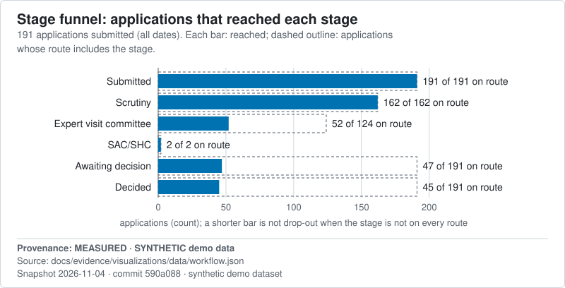
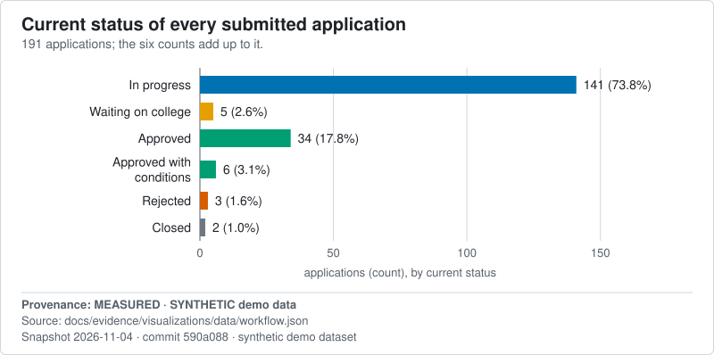
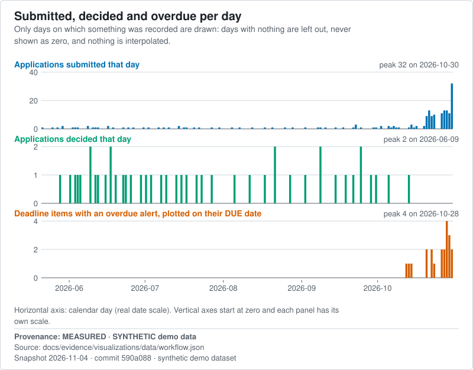
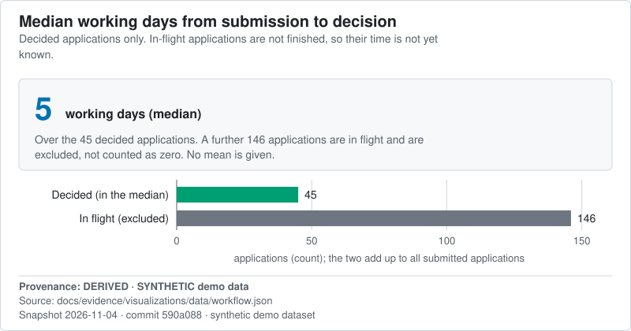
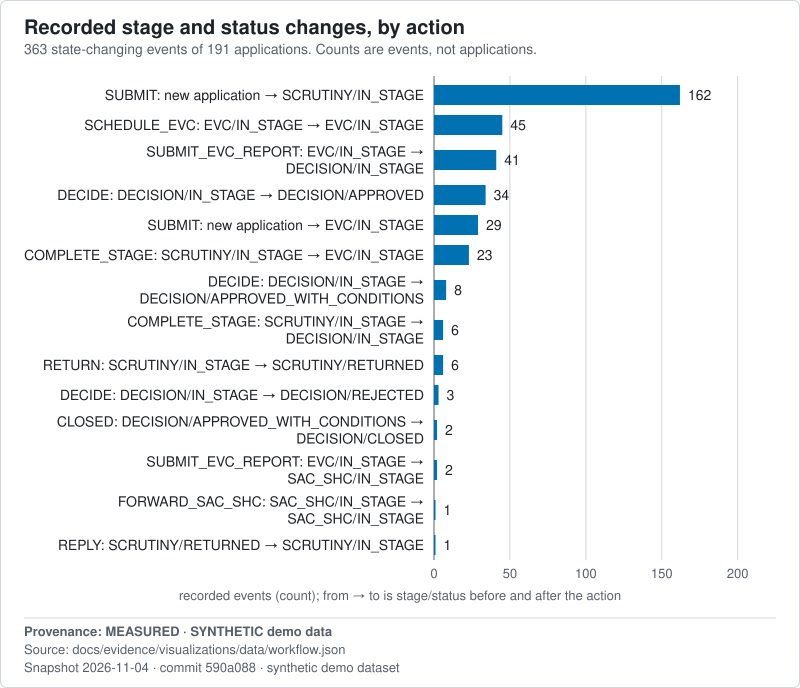

<!-- Generated by `npm run evidence:visualize` from the committed data. Do not edit by hand. -->

# Workflow

[← Evidence visualizations](../README.md) · [Methodology](../METHODOLOGY.md) · [Evidence index](../../README.md)

How applications move through the stages, where they are now, and how long finished ones took. Every figure is about the applications submitted in the window (here: all dates).

Snapshot 2026-11-04 at commit `590a088`. All figures are from a synthetic demo dataset.

## Stage funnel: applications that reached each stage

**What it shows.** Of 191 submitted applications, how many have reached each stage, against how many have that stage on their route (the dashed outline).

**How it was measured.**

> Number of distinct applications that have reached each stage, counted from the audit trail of stage moves (an application now decided still counts at every stage it passed through), not from its current status. "Decided" counts applications with a recorded decision. Share = applications reached / applications submitted in the window (the denominator, shown as submittedTotal); it is blank when nothing was submitted. A stage that is not on an application's route (onRoute shows how many are) cannot be reached by it, so shares below 100% are not drop-out.

Reached 52 of 124 on route for the expert visit committee stage; 45 decided.

**What you can reasonably conclude.** Where the applications in this dataset currently are, and that a stage which only some routes include (EVC, SAC/SHC) has a smaller denominator than the rest.

**What you cannot conclude.** That a shorter bar is a failure or a drop-out: an application cannot reach a stage that is not on its route. It is also not a conversion rate for any real intake, and it says nothing about how long each stage took.

Provenance: MEASURED · SYNTHETIC demo data. Source: `docs/evidence/visualizations/data/workflow.json`.

## Current status of every submitted application

**What it shows.** The current status of every submitted application, in the words the application itself uses.

**How it was measured.**

> Number of applications in each current status. Denominator: applications submitted in the window; the counts add up to it.

The status words are the ones in the application screens: In progress, Waiting on college (returned for a deficiency), Approved, Approved with conditions, Rejected, Closed.

**What you can reasonably conclude.** The mix of outcomes and in-progress work in this synthetic dataset; the six statuses cover every submitted application.

**What you cannot conclude.** An approval rate or a rejection rate for real applications: most applications here are still in progress and the outcomes come from seeded decisions.

Provenance: MEASURED · SYNTHETIC demo data. Source: `docs/evidence/visualizations/data/workflow.json`.

## Submitted, decided and overdue per day

**What it shows.** Per calendar day: applications submitted, applications decided, and deadline items that received an overdue alert (plotted on the date the item was due).

**How it was measured.**

> Per calendar day, for applications submitted in the window: how many were submitted that day, how many were decided that day, and how many deadline items of those applications the engine raised an overdue alert for, plotted on the item's due date (not on the date the alert was raised or the date the item became overdue). Starts at the first recorded event; days with no event are left out rather than shown as zero, and nothing is back-filled or interpolated. The overdue points are placed on the item's due date, which can fall outside the From/To dates (those dates select the applications, not the plotted days), so do not label the day axis with the From/To range.

**What you can reasonably conclude.** On which calendar days submissions, decisions and overdue due-dates were recorded in this dataset.

**What you cannot conclude.** A trend or a seasonal pattern: the days are seeded and clock-simulated, and days with no event are absent rather than zero, so the horizontal gaps are not a measurement of quiet periods.

Provenance: MEASURED · SYNTHETIC demo data. Source: `docs/evidence/visualizations/data/workflow.json`.

## Median working days from submission to decision

**What it shows.** The median time from submission to decision for decided applications: 5 working days, from 45 decided applications, with 146 still in flight.

**How it was measured.**

> Median working days from submission to decision (weekends and holidays excluded), over DECIDED applications only. Applications still in progress are not finished, so their processing time is not yet known (a censored sample): they are excluded from the median and reported separately as inFlightCount. decidedCount + inFlightCount = applications submitted in the window. No mean is given because averaging only the finished cases would understate the time cases take. Blank when no application in the window has been decided.

**What you can reasonably conclude.** Typical time to decision among the applications that have been decided in this dataset.

**What you cannot conclude.** How long a typical application takes: the in-flight applications are excluded because their time is not yet known, so the median describes only the finished ones and is likely to understate. It is a figure from seeded data, not AICTE's turnaround time, and it is not a compliance statement.

Provenance: DERIVED · SYNTHETIC demo data. Source: `docs/evidence/visualizations/data/workflow.json`.

## Recorded stage and status changes, by action

**What it shows.** Every kind of recorded state change, as the action that caused it and the stage/status before and after, with how many times it happened.

**How it was measured.**

> Number of recorded state changes of the applications submitted in the window, grouped by the action that caused them and by the stage and status the application was in before and after, counted from the audit trail (each audit row stores the application's stage and status before and after the action). total = such events; applications = distinct applications with at least one. SUBMIT has no earlier state (the application did not exist), shown as from = null. A move from a stage to the same stage with a different holder (for example scheduling a visit) is a transition row but not a stage change. Only actions that changed the stored state are counted: events that are not state changes (assignments, alerts, sign-ins) carry no state and are not counted, and nothing is inferred for a stage move that was not audited. Counts are events, not applications: an application returned and resubmitted is counted each time. Same cohort as every other figure here (applications submitted in the window; the window does not cut the events themselves). Blank (null), with no moves, when no application was submitted in the window.

**What you can reasonably conclude.** Which paths applications actually took through the workflow in this dataset: read each bar as an action and the state change it made.

**What you cannot conclude.** The order of steps for any one application, or time spent between steps. Counts are events, and an application that was returned and resubmitted is counted each time. A move that was not audited is not inferred.

Provenance: MEASURED · SYNTHETIC demo data. Source: `docs/evidence/visualizations/data/workflow.json`.

---

[← Evidence visualizations](../README.md)
